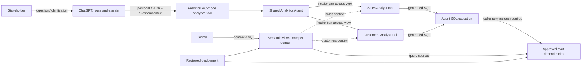

# One metric source for Sigma and ChatGPT

Business stakeholders want to ask questions about organizational data in plain language and trust the answers as much as their dashboards. The proposed foundation is a shared set of Snowflake metric definitions, used by Sigma and an Analytics plugin in ChatGPT. A Snowflake Agent handles the data analysis behind a Model Context Protocol (MCP) connection. Sales and customers are example domains that can be replaced with the organization's own data.

For product readers, start with the [short summary](investigation_spike_summary.md), recommendation, and stakeholder experience. Setup, validation, and rollout suggestions are maintained [separately](pilot_suggestions.md).

| Evidence level | What is established | What remains uncertain |
| --- | --- | --- |
| Vendor-documented | Agent/MCP configuration, caller-role authorization, partial-access behavior, OAuth controls, and Sigma limitations. | Compatibility with the target account, policies, and ChatGPT workspace. |
| Locally validated | The Terraform configuration and saved mocked-plan checks validate the intended resource and grant graph. | Actual resource creation, effective permissions, and client behavior. |
| Live verification | No live execution evidence is included for these example domains. | Target-account Sigma behavior, Agent/MCP personal OAuth, domain isolation, final-answer accuracy, deployment promotion, and operating cost. |

## Recommendation and decisions needed

**Use a shared semantic layer with caller-specific domain authorization.** Define metrics in Git, deploy them to Snowflake semantic views, and have Sigma and ChatGPT use those definitions. Matching numbers are an acceptance criterion, not a guarantee supplied by connecting the tools. The [Terraform reference configuration](analytics_mcp_poc.tf) describes one shared Agent with two domains and three consumer roles.

- **Choose one deployment owner** for marts, semantic views, and verified queries. Use the existing dbt, schema-migration, or reviewed SQL delivery process, with definitions versioned in Git.
- **Start with one Analytics MCP endpoint, one shared Analytics Agent, and one ChatGPT plugin.** Give the Agent one Analyst tool per semantic view and use domain-specific consumer roles. Separate domain Agents remain an option if ownership or partial-access behavior calls for them.
- **Keep the business endpoint limited to approved `CORTEX_AGENT_RUN` tools.** Do not expose standalone `SYSTEM_EXECUTE_SQL`, including read-only mode. Internal Agent traces can still contain SQL-execution steps. [Tool configuration][sf-create]
- **Preserve existing dashboards during migration.** Shared definitions must support the workbook behavior and data visibility that stakeholders rely on.

**Reference approach:** use the Snowflake-managed Analytics MCP endpoint and document its operating/audit ownership. Sigma and ChatGPT share semantic definitions; account-specific policies, data visibility, and required workbook features must fit the target environment.

The remaining gates determine whether the proposed managed Agent path is suitable:

| Gate | Decision required | Why it changes the design | Proposed owner |
| --- | --- | --- | --- |
| G1: Data and metric boundary | Must users be limited to semantic views and named metrics, or may they explore approved underlying data? | Direct semantic SQL needs only view access; Snowflake documents additional source-table access for Agents. An Agent binding does not enforce exclusive use of named metrics. [Direct SQL][sf-query], [Agent requirements][sf-best] | Product + Analytics + Data Platform + Security |
| G2: Identity and client behavior | Can the target ChatGPT workspace use personal OAuth connections with the intended role, tool approvals, follow-ups, and warnings? | Vendor support alone does not prove the connection preserves the intended identity or answer behavior. | IT + workspace admins + Data Platform |

**G1 needs an explicit answer before stakeholder rollout.** Removing a SQL tool from ChatGPT does not remove permissions held by its Snowflake identity. If view-only access is mandatory, do not fix Agent failures by granting broad mart access; evaluate the constrained execution option below.

## What the stakeholder experience should be

The proposed product supports approved aggregate questions over supported domains. Examples include order counts, trends, and breakdowns over supported dates and dimensions. Individual customer lookups, raw exports, cross-domain joins, scheduled delivery, writes, and causal explanations require separately defined behavior and approval. These are proposed product boundaries, not capabilities already enforced by the platform.

| Stage | Stakeholder experience | What must happen behind it |
| --- | --- | --- |
| Data is ready | See which questions are supported and how current the data is. | A domain owner approves definitions, supported history, freshness expectations, and example questions. Pipeline failures must not produce an unexplained “current” answer. |
| Connect | Install/select Analytics and sign in with their own Snowflake identity through the configured sign-in flow; reconnect when authorization expires. | IT provisions the user and domain role; admins enable the plugin and MCP capabilities; personal OAuth binds the connection to the approved role. |
| Ask and clarify | “How many orders were placed last month?” If order status or the period is ambiguous, get a targeted clarification or an explicit approved default. | ChatGPT invokes the shared Analytics Agent. The Agent chooses among Analyst tools the caller can access and resolves the business definition and exact date range. |
| Retrieve | Wait for a query result, with a useful failure message if retrieval fails. | The Agent uses Cortex Analyst to generate SQL and executes it with the caller's permitted Snowflake access. A successful HTTP response alone does not establish a complete answer. |
| Understand and verify | Receive the number, definition, period, filters, freshness, and an available Sigma comparison link. | ChatGPT preserves the Agent result, units, qualifications, and warnings. Engineering can trace the answer to SQL, query IDs, and deployed definitions. |
| Follow up or report a problem | “Break that down by product category.” Report an incorrect answer with enough context for support. | Preserve the intended metric, period, filters, and scope across turns; retrieve again when needed. Feedback reaches an owner and becomes a regression case. |

Proposed answer contract: **result + metric meaning + exact period/timezone + filters and grain + source freshness + completeness warning, if any + verification reference**. For example, an answer should identify whether it counted distinct customers, orders, or order lines. Values and links must come from actual execution; do not invent a freshness timestamp or Sigma link when the integration does not supply one. A query timestamp describes when the query ran, not when its source finished loading.

“No matching rows,” “zero,” “not authorized,” “unsupported question,” “stale data,” and “query failed” are different outcomes. The system must preserve those distinctions. A request for “why” can identify measured contributors, but should not present a causal explanation that the available data cannot establish.

## How the end-to-end workflow works

| Term | Plain-language meaning |
| --- | --- |
| Mart | A business-oriented table or view with a defined grain, history, and owner. |
| Semantic view | Snowflake definitions for business metrics, dimensions, and relationships over those marts. It does not itself make source data fresh or correct. |
| Cortex Analyst | Snowflake's component that interprets a data question and generates SQL using semantic context. |
| Analytics Agent | A configured Snowflake Agent that plans a question, selects an accessible domain tool, executes analysis, and composes a response. One shared Agent can cover several domains; separate domain Agents are optional. |
| MCP | The tool interface between ChatGPT and Snowflake. It connects systems; it does not define metrics. |
| Analytics plugin | The stakeholder-facing package/entry point in ChatGPT. Plugin availability and connected-account data permissions are separate. |

There are two reasoning layers: ChatGPT chooses a tool and presents the final answer; the Snowflake Agent plans and answers the data request. Both can introduce mistakes. Validate the final ChatGPT answer as well as the SQL and intermediate Agent result.

The diagram shows requests and dependencies; results return through the calling path. The important distinction is that **Sigma can query the semantic view while the Agent can execute physical SQL against its sources**. Semantic-view materializations therefore do not automatically accelerate Agent queries. [Execution paths][sf-materializations]

The question/context sent to Snowflake and the result/trace sent back to ChatGPT cross a system boundary. “Hosted by Snowflake” does not mean the complete workflow stays in Snowflake. Review the actual payload with representative questions, especially before adding customer data.

### Frontend alternative: Snowflake CoWork

Snowflake CoWork provides a native conversation UI for the same Cortex Agents. It removes the ChatGPT reasoning layer and its MCP/OAuth connection setup, and Snowflake documents displaying skipped-tool warnings with the answer. Stakeholders would adopt another interface; source-data permissions and metric certification still apply. It remains a frontend alternative to the reference ChatGPT path through Snowflake-managed MCP. Model/region and data-handling requirements still need review; avoid an unqualified claim that all processing stays in Snowflake. [CoWork architecture][sf-cowork], [Warning display][sf-partial]

### From definition to a deployed answer

1. **Agree on the question and metric.** A domain steward defines entities, grain, time semantics, supported filters, and expected outputs with Analytics.
1. **Build and validate marts.** Use appropriate current-state, event, and historical models; check uniqueness, joins, freshness, and late-arriving data. Record each mart's grain, supported history, and owner.
1. **Deploy semantic definitions.** Version metrics, relationships, descriptions, synonyms, and verified queries alongside their dependencies. Verified queries are examples that help generation; they are not an execution allowlist. [Modeling guidance][sf-modeling]
1. **Deploy Agent and MCP configuration.** Add one Analyst tool/resource per view to the shared Agent, with reviewed warehouse, instructions, execution limits, and `orchestration.tool_not_accessible: accept`. Expose that Agent as the MCP's single `analytics` tool. Keep unrelated Search, custom, web, coding, and recursive Agent/MCP tools out of the business endpoint.
1. **Provision and connect.** Apply narrow domain roles, personal OAuth, workspace access, and the chosen Sigma connection identity. Verify the effective identities rather than inferring them from the sign-in screen.
1. **Validate the entire answer path.** Run the same questions through direct semantic SQL, Sigma, the Agent, and ChatGPT. Inspect numerical results, selected definitions, SQL, warnings, and final prose.
1. **Operate and improve.** Monitor data health, answer failures, latency, cost, and feedback. Promote reviewed corrections through the same release process.

## Critical gap: access control is not metric enforcement

**Snowflake RBAC enforces which data the identity can access. Semantic metadata helps the model decide how to query it.** A source-table grant can allow access to fields absent from the semantic view and queries outside the plugin, subject to applicable policies and authentication controls. Omitting a standalone SQL MCP tool reduces the exposed tool surface; it does not turn a semantic-view binding into a SQL allowlist.

Choose the product contract deliberately:

| Option | What it provides | What still needs work |
| --- | --- | --- |
| Managed Analytics Agent over approved sources | Flexible exploration with personal Snowflake authorization and managed execution. | Explicitly approve and minimize source grants, including every accessible field and row. Test whether generated SQL preserves certified metric meaning. Do not promise named-metric-only execution. |
| Constrained metric execution through a domain service | Proposed alternative if G1 requires only approved metrics and view-only access: accept validated metric/dimension/filter parameters and execute reviewed semantic SQL. | Design the service contract, authorization, supported query shapes, and audit trail if that requirement changes the managed-Agent approach. This is additional implementation, not a built-in switch on `CORTEX_AGENT_RUN`. |

For the managed path, investigate purpose-built, policy-protected source relations that contain only approved data. Their compatibility with the Agent and semantic view must be tested. They reduce exposure but still do not enforce exclusive use of approved metric formulas. A privileged shared service identity is not a shortcut: it requires its own caller authorization and row-policy design.

### Who gets access?

**Snowflake determines domain access from the caller's authenticated session role.** ChatGPT sends each person's OAuth token; it does not maintain a separate domain permission list. Configuring an Agent's tool resources tells it which views to use, while grants on the caller's role determine what it may access. The managed Agent does not gain broader data permissions just because its owner can read both domains. [Caller-role enforcement][sf-agent-access]

The [POC](analytics_mcp_poc.tf) implements this access matrix using three roles and three existing test users:

| Effective Snowflake role | Shared MCP and Agent | Sales view / sources | Customers view / sources |
| --- | --- | --- | --- |
| `ROLE_SALES_ANALYTICS_POC` | Allow | Allow | Deny |
| `ROLE_CUSTOMERS_ANALYTICS_POC` | Allow | Deny | Allow |
| `ROLE_ALL_ANALYTICS_POC` | Allow, inherited | Allow, inherited | Allow, inherited |

The combined role inherits the two domain roles. These are normal privileges inherited by the primary role; they work with OAuth secondary roles disabled. Each test user is assigned only their intended POC role by this stack. Existing user grants and `PUBLIC` still need review.

### What happens when a user has only one domain?

The shared Agent has two separately named Analyst tools, `sales` and `customers`, each with one semantic-view resource. With top-level `orchestration.tool_not_accessible: accept`, Snowflake checks view access before planning, skips an inaccessible Analyst tool, and continues with the tools the caller can use. Source-table privileges are checked later when SQL executes. A customers question from a sales-only user must produce an access limitation, not an answer substituted from sales data. [Partial-access checks][sf-partial]

`reject` would fail the shared run if either configured view tool were inaccessible. Reserve that mode for a separate domain Agent whose named resources are all required. `accept` can return HTTP success with warnings, including when the requested domain is unavailable; the final ChatGPT answer must preserve the limitation. Skipped tools produce warning code `399569`; non-streaming Agent responses include a top-level `warnings` array. The warning does not distinguish missing objects from unauthorized objects, so the user-facing explanation must preserve that uncertainty. [Warning contract][sf-partial]

All three POC users should see the same single `analytics` MCP tool. Listing that tool does not establish access to both internal domains, and a denied tool/resource name may still be visible in specifications or warnings. Separate domain Agents are an ownership and authorization option, not a requirement for different domain access. The managed MCP limit counts exposed tools, not metrics; this shared-Agent POC uses one MCP tool. [MCP metadata][sf-describe], [Agent resources][sf-agent-run]

The managed Agent path needs the following grant categories. This is a design checklist, not a deployable grant script:

| Privilege / setting | Required scope or decision |
| --- | --- |
| Database and schema `USAGE` | Shared MCP location, allowed Agent/view locations, and approved source dependencies required by the selected path. |
| `USAGE ON MCP SERVER` | Shared `ANALYTICS_MCP_POC` in the reference configuration. The general privilege reference explicitly includes discovery and invocation under `USAGE`; the MCP guide also lists calls under `MODIFY`. Treat this as a documentation discrepancy requiring live confirmation, not a reason to grant consumer management access. [Privilege reference][sf-privileges], [MCP guide][sf-mcp] |
| `USAGE ON AGENT` | The shared Analytics Agent for both domain roles; the combined role inherits this access. Internal view/source grants determine available domains. |
| `SELECT ON SEMANTIC VIEW` | Explicitly approved views. Grants cover the whole view, not individual metrics. |
| Source-relation `SELECT` and parent access | Documented requirement for Agent execution. Enumerate and approve dependencies; these grants are intentionally absent from the direct semantic-SQL-only path. |
| `SNOWFLAKE.CORTEX_AGENT_USER` database role | Explicit Agent feature entitlement for the consumer account role; separate Agent and data grants are still required. [Agent access][sf-agent-access] |
| Warehouse `USAGE` | Configured Agent tool warehouse and a usable MCP session default warehouse. |
| No management or write privileges | No Agent/MCP modification, object creation, grant options, or unrelated engineering role inheritance. |

`SNOWFLAKE.CORTEX_USER` is granted to `PUBLIC` by default and may already provide broader Cortex feature entitlement. That does not grant access to this Agent, semantic views, or source tables, and does not invalidate the domain authorization model. Audit effective inherited privileges before claiming an Agent-only feature role. Any account-wide change to `PUBLIC` needs its own impact review. [Default entitlement][sf-agent-start], [Object privileges][sf-privileges]

Snowflake's Agent setup page lists `USAGE` for referenced tables, while semantic-view best practices explicitly require source-table `SELECT` for Agents. The reference configuration conservatively grants exact source `SELECT`; the actual minimum remains unverified. Parent database/schema `USAGE` is a separate requirement. [Setup table][sf-agent-access], [Source requirements][sf-best]

Review inherited roles, `PUBLIC`, future grants, and indirect exposure through approved dependencies. Prefer explicit object grants. Row-access and masking policies must work in both query paths; sample values and other metadata need separate review because masking does not protect metadata. [Policy behavior][sf-best]

A shared endpoint also shares metadata: MCP users can inspect its tool specification. A secure Agent can hide its specification from non-owners, but resource names can still appear in warnings. Separate endpoints or a filtering gateway may be needed if even domain names are sensitive. [MCP metadata][sf-describe], [secure Agents][sf-secure]

### Personal identity, OAuth, and revocation

Each stakeholder needs their own Snowflake user for the proposed personal OAuth path. The identity team should provision users through the organization's chosen identity process, configure sign-in, map groups to narrow roles, and set a usable default role/warehouse. User provisioning and role assignment must both be covered.

One confidential Snowflake OAuth integration registers ChatGPT as the client and serves all three access levels. The client ID/secret are shared application credentials; each consumer still signs in separately and receives a personal access token. `ALLOWED_ROLES_LIST` permits eligible roles to be used through that integration; it does not grant a role to a user or grant domain data access. The POC allowlists all three consumer roles and assigns the domain privileges separately. [OAuth integration][sf-mcp], [Role restrictions][sf-oauth]

Use a dedicated stakeholder OAuth integration. Set `ALLOWED_ROLES_LIST`, `OAUTH_USE_SECONDARY_ROLES = NONE`, and keep `OAUTH_ANY_ROLE_MODE = DISABLE`; verify the client does not acquire broader inherited access. These settings apply to Snowflake OAuth; External OAuth has a different configuration contract. [OAuth controls][sf-oauth]

The reference configuration pins provider 2.22.0 and manages the role allowlist and secondary-role setting natively. Its custom-client resource does not expose `OAUTH_ANY_ROLE_MODE`; the newly created integration relies on Snowflake's `DISABLE` default. Include that setting in deployment verification and drift checks. [Provider fields][tf-oauth]

The default MCP `session:role:all` scope uses the user's `DEFAULT_ROLE`; it does not combine every assigned role. Check what ChatGPT actually requests and what Snowflake uses. A different integration alone does not select a different default role. For users with an existing engineering default, test explicit role scopes before changing defaults that other workflows rely on. [MCP session roles][sf-mcp]

Current OpenAI instructions explicitly support adding a custom MCP server as a plugin, including predefined OAuth client credentials. Snowflake's older Developer Mode instructions do not establish the current distribution requirement. The actual workspace still needs suitable plugin installation, audience, and MCP permissions, with personal connections selected. Register the exact callback shown by that connection. [Current client setup][oai-custom-mcp], [Authentication][oai-mcp], [Workspace controls][oai-controls]

Refresh-token lifetime is a product and security choice. The reference configuration exposes `oauth_refresh_token_validity_seconds`, defaulting to 86,400 seconds (24 hours), versus Snowflake's 90-day custom-client default. Expiry requires authorization again; SSO and client behavior determine whether credentials must be entered again. [Token lifecycle][sf-oauth-lifecycle]

ChatGPT's verified-domain restriction is a separate control that can prevent a corporate identity being linked in a personal or outside workspace. It requires OIDC discovery, `openid`/`email` scopes, and a UserInfo endpoint returning a verified email. Snowflake OAuth compatibility with these requirements has not been established. Workspace audience controls and Snowflake role grants do not by themselves establish this restriction. [Domain restriction requirements][oai-domain]

Offboarding must address identity-provider assignment, Snowflake user/role access, active OAuth authorization, and ChatGPT workspace access. Test revocation with an existing connection, an existing conversation, and a new session. Revoking future retrieval cannot erase results already copied into a chat, export, or shared artifact; those need the applicable retention and sharing controls.

## Metric consistency needs a business contract

For every supported metric, record the following in the reviewed semantic definition or its existing metadata. Product and Analytics approve the meaning; engineering implements and tests it.

| Contract field | Example of ambiguity to resolve |
| --- | --- |
| Entity and grain | Customers, accounts, orders, or order lines? Can one customer contribute multiple orders? |
| State versus events | Orders placed during a period, paid during it, or open at period end? A current-state table cannot reconstruct unsupported history. |
| Time | Exact period boundaries, business timezone, week start, complete versus partial periods, and event time versus ingestion time. |
| Aggregation | Distinct counts are not generally additive; rates need the correct numerator and denominator rather than an average of percentages. |
| Joins and history | One-to-many fanout, unmatched/null keys, overlapping validity windows, repeat orders, and point-in-time versus current customer attributes. |
| Scope and exclusions | Test/internal records, products/categories included, canceled or refunded orders, deleted accounts, and any access-policy differences. |
| Freshness and revisions | Last successful source load, late-arrival/backfill policy, available historical coverage, and when prior answers can legitimately change. |
| Ownership and compatibility | Named steward, approved synonyms, supported dimensions, definition version, and how a changed definition affects workbooks and prior answers. |

“Same question” is insufficient for a parity test. Match the metric definition/version, grain, absolute dates, timezone, filters, effective visibility, and source snapshot/load. Account for Sigma cache/materialization freshness where used. Choose an independent, analyst-reviewed reference calculation; two tools can agree on the same incorrect definition.

Start with a bounded set of questions whose expected results and explanations are reviewable. Include ambiguous and unsupported questions, follow-ups, and requests for unmodeled fields. Cross-domain arithmetic or a person-level join needs an approved contract; independently querying two domain tools does not establish compatible populations or denominators.

## Sigma compatibility and future changes

Sigma can use shared semantic definitions, but required workbook behavior must fit the chosen integration. The following vendor-documented **private-beta** limitations are reference material when selecting or extending a workbook. [Current limitations][sigma-sv]

| Limitation | Design implication |
| --- | --- |
| Facts cannot be queried; derived metrics are unavailable. | Shared definitions must expose the needed supported metrics and dimensions. |
| Same-named dimensions from different tables make the view unqueryable. | Use distinct dimension names across the view. |
| Controls cannot target a semantic-view source or source list/segmented values from it. | Existing workbook interactions may need redesign. |
| Joins/unions/transpose, child-element metrics/relationships, public APIs, and some public-embed behavior are unsupported. | Workbook migration needs a feature-by-feature compatibility decision. |

Use a representative Sigma workbook as the baseline for additional workbooks and domains. Review filter placement, grain, rollups, and workbook behavior when the source or query shape changes. Preserve the shared metric definitions in any adaptation.

Sigma key-pair connections use a service account; OAuth can preserve individual Snowflake identities. Choose which identity and policies must match the ChatGPT path. Audience-specific connections and Sigma role configuration may suit shared dashboards, but equivalent visibility needs proof; a service account does not inherently apply each viewer's `CURRENT_USER()` policies. Include connection-level SQL and shared workbook access in the review. [Sigma authentication][sigma-auth]

Keep the old workbook available while validating the new one, including refreshes, controls, downstream elements, embeds, and any API consumers actually used. Record the source migration and known limitations with the workbook owner.

## Integration behaviors to prove early

| Likely issue | Required investigation / improvement |
| --- | --- |
| Extra approval prompts or blocked read actions | `CORTEX_AGENT_RUN` defaults to `readOnlyHint: false` and `destructiveHint: true`. After verifying all configured tools and grants are read-only, set accurate annotations and test workspace action controls. An annotation is a client hint, not authorization. [Snowflake annotations][sf-mcp], [ChatGPT handling][oai-custom-mcp] |
| An apparently successful but incomplete answer | The shared POC Agent explicitly uses `orchestration.tool_not_accessible: accept` so a denied domain does not block an allowed one. Verify skipped-view warnings reach ChatGPT, missing source grants fail during execution, and a denied-domain question is not answered from a different domain. `reject` remains appropriate when every configured resource is required. Current docs describe `accept` as the default and the release notice dates the change to September 2, 2026. [Modes][sf-partial], [release notice][sf-partial-rollout] |
| Follow-ups lose filters or change domains | Agent runs support threads or supplied message history. Capture the actual MCP request/response to establish how this integration carries context; do not assume a ChatGPT conversation automatically corresponds to a persistent Snowflake thread. Test changed filters, pronouns, corrections, and a new chat. [Agent Run API][sf-agent-run] |
| Large payloads or information beyond the final answer | The managed Agent MCP response includes intermediate steps and can exceed 200 KB. Inspect traces, SQL, warnings, and returned rows for disclosure and client handling; the documented 250 KB limit for generic/SQL tools is not a stated Agent-tool limit. [Response behavior][sf-mcp] |
| Wrong domain tool or altered final explanation | Use precise descriptions for the shared Agent's two Analyst tools. Test internal tool selection and final ChatGPT numbers, qualifiers, charts, and any arithmetic. A correct Agent result is not sufficient if the final answer changes its meaning. |
| A client, model, or configuration change alters behavior | Establish ChatGPT web as the initial supported client; validate desktop separately. Record Agent instructions, model selection, version/default target, tool catalog, and client surface with each baseline. Refresh the plugin catalog after reviewed tool changes. [Client setup][oai-custom-mcp], [Agent versions][sf-partial] |

## Ownership and release process

| Area | Proposed accountable team | Required output |
| --- | --- | --- |
| Product scope and adoption | Product + domain sponsor | Intended audience, useful questions, exclusions, answer contract, and success criteria. |
| Metric meaning and quality | Analytics + named domain steward | Approved definitions, reference calculations, representative Sigma workbook, and feedback review. |
| Data and managed Snowflake objects | Data Platform | Mart/semantic-view delivery, Agent/MCP configuration, deployment ownership, access tests, and operational support. |
| Identity and workspace | IT/Security + ChatGPT admins | Provisioning, roles, OAuth, plugin audiences/action settings, revocation, and data-handling approval. |
| Platform architecture | Platform Engineering + Data Platform | Document the Snowflake-managed endpoint's operating ownership, identity propagation, and audit responsibilities. |

These are proposed responsibilities; assign a named owner and backup before onboarding. Resolve support routing before users encounter a wrong answer or failed sign-in.

Use the chosen semantic-definition delivery tool and Terraform for supported infrastructure/configuration. Current provider docs include `snowflake_mcp_server` and `snowflake_cortex_agent`; check the version pinned in the infrastructure configuration. Prove support for the required OAuth settings, secure Agent designation, version promotion, and grant preservation. Assign unsupported fields to an explicit reviewed SQL/API deployment step with drift checks rather than assuming full provider coverage. [MCP resource][tf-mcp], [Agent resource][tf-agent]

In provider 2.22.0, Agent version metadata is read-only; the native resource does not expose version promotion controls. Committed versions are immutable. Define an explicit reviewed SQL step for version creation and default/alias promotion, through the deployment pipeline or Terraform's `snowflake_execute` resource. Choose one owner and define drift/rollback behavior; SQL execution does not provide native version reconciliation. [Provider coverage][tf-agent], [SQL execution resource][tf-execute], [Version behavior][sf-partial-rollout]

**A periodic snapshot cannot guarantee recovery of a UI edit made after the last snapshot and overwritten by the next deploy.** Capture/review live changes immediately before deployment or require reviewed Git changes before publication. Execute verified queries against the target schema; stored example SQL is not proof that it still runs.

The Snowflake Labs dbt package supports `create_or_alter=true` to preserve grants/materializations; its default is replacement, with a separate `copy_grants` option. Pin and verify the installed package behavior. `COPY GRANTS` preserves grants on replacement, not UI-added query definitions omitted from the new specification. [Package behavior][dbt-package], [Snowflake DDL][sf-ddl]

Release in dependency order: schemas/roles → marts → semantic views → Agents → MCP → consumer grants → Sigma/plugin. Validate environment-qualified references, especially verified SQL and Agent resources, so development never silently queries production. Snapshot definitions, policies, grants, verified queries, and the active Agent version before release; check them afterwards. Changes to the Agent's live specification do not necessarily change the committed default version serving users. [Versioned configuration][sf-partial]

Use one deployment owner per object. Publish breaking metric/schema changes with a migration window for affected workbooks and questions. Roll back to the reviewed definition/configuration set and restore required grants; verify the old definition still works with the current mart schema. Emergency containment should disable the affected tool/access path and stop costly active work where supported, then verify new and existing sessions. Plugin removal alone is not a complete Snowflake revocation or query-cancellation strategy.

## Supporting evidence and limits

| Evidence | Status and practical limit |
| --- | --- |
| Snowflake managed Agent/MCP and access requirements | Vendor-documented behavior, checked during this review. The target account configuration and ChatGPT path need live verification. |
| Local [Terraform POC](analytics_mcp_poc.tf) | Implements the shared Agent/two-view tool configuration and the three-role access matrix. Formatting, provider-schema validation, and the saved [mocked-plan checks](analytics_mcp_poc.tftest.hcl) passed. These do not prove live role enforcement, partial-access warnings, or ChatGPT behavior. |
| Sigma integration | The vendor documents semantic-view support and its limitations. Validate required workbook behavior and data visibility in the target environment. |

Attach reproducible evidence to the implementation review: date, environment, least-privileged role, deployed definition/config version, question, expected/actual result, query/run IDs, and sanitized failure output. Use accessible artifacts that reviewers can reproduce.

## Operational gaps to close before expansion

- **Latency and compute:** Measure ChatGPT routing + Agent orchestration + Analyst generation + warehouse queue/execution + final explanation. Configure separate orchestration budgets and tool `query_timeout`; orchestration token limits do not include all tool tokens. Optimize shared marts for both paths, since semantic-view materializations do not cover physical SQL. [Run configuration][sf-agent-run], [Budget limits][sf-agent-manage], [Execution paths][sf-materializations]
- **Spend:** Account for orchestration, Analyst, warehouse queries, retries, and both evaluation and user traffic, plus ChatGPT workspace costs. Warehouse resource monitors do not control AI/serverless spend. Evaluate Agent resource budgets and per-user AI quotas separately: documented budget actions can lag by hours, while quota enforcement operates within minutes; both can overshoot. CoWork-initiated requests are attributed to CoWork, so Agent-only budget scope does not cover that path. Confirm coverage and account availability rather than promising a hard per-answer cap. [Agent costs][sf-agents], [Warehouse monitors][sf-monitors], [Agent budgets][sf-agent-budgets], [User quotas][sf-quotas]
- **Traceability and support:** Prove correlation from the visible ChatGPT answer to the Agent run, effective identity, generated SQL/query IDs, configured views, version, filters, and warnings. Keep sensitive payloads out of routine application logs. Restrict monitoring access and explicitly approve unredacted trace access when required. [Monitoring][sf-monitor], [Trace permissions][sf-events]
- **Accounting versus debugging:** Agent observability telemetry is best-effort and can be incomplete or late. Use authoritative usage-history views for cost reconciliation; a trace log alone is not complete billing or security-audit evidence. [Telemetry limitations][sf-events]
- **Freshness and change detection:** Alert on failed/late source loads, policy/grant drift, changed Agent bindings, missing verified queries, answer failures, and the certified-question baseline. Re-run parity cases after meaningful data/model/configuration changes and vendor behavior changes.
- **Data handling and recovery:** Agree which questions, aggregates, customer fields, sample values, SQL, and traces may leave Snowflake; review actual model/region routing and retention in both systems. Exercise a failed-login support case, a bad-answer report, a cost stop, and a domain disable before expanding the audience. [Workspace data handling][oai-controls], [Model routing][sf-agents]

[dbt-package]: https://github.com/Snowflake-Labs/dbt_semantic_view
[oai-controls]: https://learn.chatgpt.com/docs/enterprise/apps-and-connectors
[oai-custom-mcp]: https://developers.openai.com/api/docs/guides/custom-mcp-server
[oai-domain]: https://developers.openai.com/plugins/build/auth#support-workspace-domain-restrictions
[oai-mcp]: https://developers.openai.com/plugins/build/auth
[sf-agent-access]: https://docs.snowflake.com/en/user-guide/snowflake-cortex/cortex-agents-setup
[sf-agent-budgets]: https://docs.snowflake.com/en/user-guide/snowflake-cortex/cortex-agents-resource-budgets
[sf-agent-manage]: https://docs.snowflake.com/en/user-guide/snowflake-cortex/cortex-agents-manage
[sf-agent-run]: https://docs.snowflake.com/en/user-guide/snowflake-cortex/cortex-agents-run
[sf-agent-start]: https://docs.snowflake.com/en/user-guide/snowflake-cortex/cortex-agents-get-started
[sf-agents]: https://docs.snowflake.com/en/user-guide/snowflake-cortex/cortex-agents
[sf-best]: https://docs.snowflake.com/en/user-guide/views-semantic/best-practices-dev
[sf-cowork]: https://docs.snowflake.com/en/user-guide/snowflake-cortex/snowflake-cowork
[sf-create]: https://docs.snowflake.com/en/sql-reference/sql/create-mcp-server
[sf-ddl]: https://docs.snowflake.com/en/sql-reference/sql/create-semantic-view
[sf-describe]: https://docs.snowflake.com/en/sql-reference/sql/desc-mcp-server
[sf-events]: https://docs.snowflake.com/en/sql-reference/local/ai_observability_events
[sf-materializations]: https://docs.snowflake.com/en/user-guide/views-semantic/materializations
[sf-mcp]: https://docs.snowflake.com/en/user-guide/snowflake-cortex/cortex-agents-mcp
[sf-modeling]: https://docs.snowflake.com/en/user-guide/views-semantic/best-practices-modeling
[sf-monitor]: https://docs.snowflake.com/en/user-guide/snowflake-cortex/cortex-agents-monitor
[sf-monitors]: https://docs.snowflake.com/en/user-guide/resource-monitors
[sf-oauth]: https://docs.snowflake.com/en/sql-reference/sql/create-security-integration-oauth-snowflake
[sf-oauth-lifecycle]: https://docs.snowflake.com/en/sql-reference/sql/alter-security-integration-oauth-snowflake
[sf-partial]: https://docs.snowflake.com/en/user-guide/snowflake-cortex/cortex-agents-inaccessible-tool-handling
[sf-partial-rollout]: https://docs.snowflake.com/en/release-notes/bcr-bundles/un-bundled/bcr-2425
[sf-privileges]: https://docs.snowflake.com/en/user-guide/security-access-control-privileges
[sf-query]: https://docs.snowflake.com/en/user-guide/views-semantic/querying
[sf-quotas]: https://docs.snowflake.com/en/user-guide/budgets/per-user-quotas
[sf-secure]: https://docs.snowflake.com/en/user-guide/snowflake-cortex/cortex-agents-secure
[sigma-auth]: https://help.sigmacomputing.com/docs/connect-to-snowflake
[sigma-sv]: https://help.sigmacomputing.com/docs/query-and-extend-snowflake-semantic-views-in-sigma
[tf-agent]: https://github.com/snowflakedb/terraform-provider-snowflake/blob/accf5ace61318f575f66ed5c390a8a033a4fb0c5/docs/resources/cortex_agent.md
[tf-execute]: https://github.com/snowflakedb/terraform-provider-snowflake/blob/accf5ace61318f575f66ed5c390a8a033a4fb0c5/docs/resources/execute.md
[tf-mcp]: https://github.com/snowflakedb/terraform-provider-snowflake/blob/accf5ace61318f575f66ed5c390a8a033a4fb0c5/docs/resources/mcp_server.md
[tf-oauth]: https://github.com/snowflakedb/terraform-provider-snowflake/blob/accf5ace61318f575f66ed5c390a8a033a4fb0c5/docs/resources/oauth_integration_for_custom_clients.md
