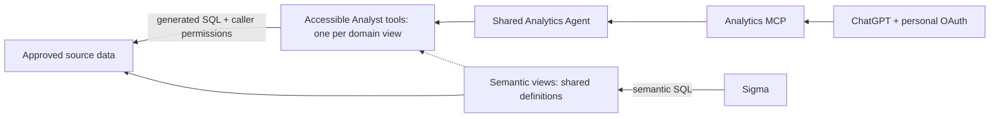

# Shared analytics for Sigma and ChatGPT

**Proposal:** define business metrics once in Snowflake semantic views, then use those definitions in Sigma and a single Analytics plugin in ChatGPT. Stakeholders sign in with their own Snowflake identity, ask questions in plain language, and receive answers within their existing domain permissions.

Start with one Snowflake-managed MCP endpoint and one shared Cortex Agent. Add domains through semantic views, Agent tools, and role grants. Introduce additional Agents or MCP endpoints when ownership, operating boundaries, or measured behavior justify them.

**Status as of 2026-10-23:** this reference design uses Snowflake-managed MCP with sales and customers as example domains. The [Terraform reference configuration](analytics_mcp_poc.tf) and saved [mocked-plan checks](analytics_mcp_poc.tftest.hcl) pass locally. The Agent/MCP POC has not been deployed; personal OAuth, live permissions, answer accuracy, and ChatGPT warning handling remain untested. See the [detailed investigation](investigation_spike.md) for supporting research and the [separate validation and rollout suggestions](pilot_suggestions.md) for execution steps.

## What we need

| Component | Purpose | Proposed owner |
| --- | --- | --- |
| Domain marts and semantic views | Define the underlying entities, joins, dimensions, metrics, and supported history. Version definitions in Git and use a single deployment owner per object. | Data Platform + Analytics/domain stewards |
| Shared Analytics Agent | Use one Cortex Analyst tool per semantic view to interpret questions, generate SQL, execute analysis, and return an answer. | Data Platform |
| Analytics MCP server | Expose the Agent as one `analytics` tool at a Snowflake-hosted URL. Keep standalone SQL execution out of the stakeholder endpoint. | Data Platform |
| Consumer roles | Give each audience access to the approved views and required source dependencies. | Data Platform + IT/Security |
| OAuth integration and user provisioning | Register ChatGPT as a client; provision individual Snowflake users through the existing identity process. | IT/Security |
| ChatGPT Analytics plugin | Configure the MCP URL, OAuth client credentials, exact callback, workspace audience, and personal connections. | ChatGPT workspace admins |
| Sigma connection/workbooks | Query the semantic views using a connection with appropriate data visibility. | Analytics / BI |

Terraform manages the control schema, shared Agent, MCP, OAuth integration, and consumer roles. Semantic views and source relations remain owned by their existing deployment process. OAuth client credentials are handed to ChatGPT through a protected admin workflow.

## How a question gets answered

1. The stakeholder asks a question such as “How many orders were placed last month?” ChatGPT invokes Analytics using that person's OAuth connection.
1. Snowflake checks the caller's role. The shared Agent selects from the semantic-view tools that role can access and clarifies ambiguous metrics or dates.
1. Cortex Analyst generates SQL; the Agent executes it with the caller's permitted access. Configuring a resource on the Agent does not grant access to it.
1. ChatGPT explains the result, preserving the metric meaning, exact period, filters, available freshness information, and any access or execution limitations.

Sigma queries semantic views directly. Agent queries can execute physical SQL against underlying sources, so sharing definitions does not automatically guarantee equal answers or performance. Compare both paths with an independent reference calculation under matching permissions, dates, filters, and source freshness. [Execution paths][sf-materializations]

Snowflake CoWork is an alternative UI for the same Agents that avoids the ChatGPT integration and second reasoning layer. It requires stakeholders to adopt another interface; source-access and metric-quality requirements still apply. [Native frontend][sf-cowork]

## How access differs by consumer

**Snowflake enforces domain access through each person's authenticated role.** Everyone can use the same MCP URL, Agent, and OAuth client registration. Their personal tokens and effective role privileges determine which data they can retrieve. ChatGPT does not keep a separate domain allowlist. [Caller permissions][sf-access]

The reference configuration describes three access levels:

| Consumer role | Shared MCP / Agent | Sales | Customers |
| --- | --- | --- | --- |
| Sales-only | Allow | Allow | Deny |
| Customers-only | Allow | Deny | Allow |
| All domains | Allow | Allow | Allow |

The all-domains role inherits both restricted roles. Keep OAuth secondary roles disabled and allowlist the three approved primary roles. The integration allowlist permits a role to be used; it does not assign that role to a user or grant data access. The default `session:role:all` scope uses the user's default role, not every role assigned to them. [OAuth behavior][sf-mcp]

The shared Agent uses `orchestration.tool_not_accessible: accept`: Snowflake skips an inaccessible semantic-view tool and continues with accessible tools. Missing source privileges can still fail when SQL runs. A successful response may contain an access warning; a denied-domain question must not receive a guessed number or a substitute answer from another domain. This needs live validation through ChatGPT. [Partial access][sf-partial]

Tool visibility is separate from data authorization. A shared endpoint can reveal tool/resource names even when the caller cannot retrieve their data. Use explicit source grants, review inherited access and row/masking policies, and do not assume prompts enforce the boundary.

Inherited Cortex feature entitlement through `PUBLIC` does not grant access to the configured Agent or its data. Audit inherited privileges, while keeping feature access, Agent/MCP usage, and data grants distinct. [Access layers][sf-access]

## How this scales

| Change | What we add or change | Additional MCP needed? |
| --- | --- | --- |
| New metric in an existing domain | Reviewed semantic definition, reference calculation, and regression questions. | No |
| New domain, such as inventory | Domain mart/view, an Analyst tool/resource on the shared Agent, scoped roles/source grants, and access/accuracy tests. | Usually no |
| New audience or access combination | Role assignments and approved inheritance; update OAuth eligibility and workspace access where needed. | Usually no |
| Domain needs independent instructions, releases, or ownership | A separate domain Agent exposed as another approved tool on the existing Analytics MCP. | No |
| Separate operating/security boundary or sensitive tool metadata | A separately scoped MCP endpoint and client connection, or a filtering gateway. | Potentially yes |
| Too many tools or poor routing | Measure tool-selection accuracy, latency, and support burden; split Agents or endpoints where that addresses the problem. | Based on evidence |

Adding a domain means approving more than a semantic view: its metric meaning, source exposure, role membership, ownership, and supported questions all need review. Update the serving Agent configuration, preserve existing grants/verified queries, refresh the client catalog when applicable, and rerun the access matrix. Expanding an all-domains role should be an explicit decision rather than an automatic future grant.

Multiple Agents let teams maintain different instructions and release schedules while preserving one stakeholder entry point. Each still uses the caller's permissions. Agents answering two domains independently do not establish that their populations, grains, or denominators can be joined or compared; cross-domain calculations need their own reviewed definitions.

The documented MCP limit is **50 exposed tools per server**, not 50 metrics. The current shared-Agent design uses one MCP tool even though the Agent has two internal Analyst tools. That does not imply unlimited Agent resources: test quality and latency as domain coverage grows. [MCP configuration and limits][sf-mcp]

### When we add another MCP

A new MCP means another server object, URL, tool configuration, grants, and client connection setup. It is useful when teams need distinct operating ownership, authentication boundaries, or a catalog whose names must be hidden from other audiences. A new endpoint alone does not change the permissions held by its users.

Within the same Snowflake account, one OAuth integration can support multiple MCPs when the permitted roles and client configuration fit. Use separate integrations when clients, callbacks, credential ownership, or lifecycle requirements differ. Decide separately whether the new connection belongs in the Analytics plugin or needs its own stakeholder entry point. [Shared OAuth integration][sf-mcp]

Separate development and production references and access. Introducing another URL must include an owner, intended audience, support contact, and an explanation of when ChatGPT should use it.

## Decisions before stakeholder rollout

| Decision | Why it matters | Owner |
| --- | --- | --- |
| Approved source exploration or strict metric-only access? | Snowflake documents source-table privileges for Agents; direct semantic SQL can work with view-only grants. Agent bindings do not force exclusive use of named metrics. If strict view-only/metric-only execution is mandatory, evaluate a constrained domain service that executes reviewed semantic SQL. | Product + Analytics + Data Platform + Security |
| Can ordinary workspace users connect as intended? | Current OpenAI docs support custom MCP plugins. Confirm workspace distribution, personal OAuth, reconnection behavior, and preserved access warnings. [Client support][oai-client] | IT + ChatGPT workspace admins |
| Who owns definitions and releases? | Choose one deployment owner per object using the team's existing tooling. Native Terraform Agent version metadata is read-only; version promotion needs a separate reviewed SQL step. Preserve definitions, grants, and the version serving traffic. [Provider coverage][tf-agent] | Data Platform + Analytics |

The reference operating model is a Snowflake-managed Analytics MCP endpoint. Assign named operating and audit owners. Use the shared semantic definitions in Sigma and retain the documented feature limitations as context when adapting workbooks.

The access distinction is a documented design constraint, not just a missing grant: granting underlying sources may expose fields absent from the semantic view and permit direct reads outside ChatGPT. Removing the external SQL tool does not remove those permissions. [View and Agent requirements][sf-best]

Sigma and ChatGPT must also have comparable data visibility. A Sigma service account does not inherently apply each viewer's Snowflake identity policies; evaluate individual OAuth or appropriately scoped connections. [Sigma compatibility][sigma-sv], [Sigma authentication][sigma-auth]

Refresh-token lifetime affects reconnection: the reference configuration defaults to 24 hours and makes the value explicit. ChatGPT's corporate-domain restriction additionally needs verified-email OIDC support, whose compatibility with Snowflake OAuth is unverified. These are separate decisions from workspace plugin availability and data access. [Token lifecycle][sf-oauth-lifecycle], [Domain restriction requirements][oai-domain]

Before broadening access, agree what data, questions, SQL, and traces may cross between Snowflake and ChatGPT, plus retention and model/region settings. Set owners and controls for warehouse and AI spend, latency, support, and emergency access removal. Warehouse resource monitors alone do not cover AI spend. [Cost controls][sf-monitors]

[oai-client]: https://developers.openai.com/api/docs/guides/custom-mcp-server
[oai-domain]: https://developers.openai.com/plugins/build/auth#support-workspace-domain-restrictions
[sf-access]: https://docs.snowflake.com/en/user-guide/snowflake-cortex/cortex-agents-setup
[sf-best]: https://docs.snowflake.com/en/user-guide/views-semantic/best-practices-dev
[sf-cowork]: https://docs.snowflake.com/en/user-guide/snowflake-cortex/snowflake-cowork
[sf-materializations]: https://docs.snowflake.com/en/user-guide/views-semantic/materializations
[sf-mcp]: https://docs.snowflake.com/en/user-guide/snowflake-cortex/cortex-agents-mcp
[sf-monitors]: https://docs.snowflake.com/en/user-guide/resource-monitors
[sf-oauth-lifecycle]: https://docs.snowflake.com/en/sql-reference/sql/alter-security-integration-oauth-snowflake
[sf-partial]: https://docs.snowflake.com/en/user-guide/snowflake-cortex/cortex-agents-inaccessible-tool-handling
[sigma-auth]: https://help.sigmacomputing.com/docs/connect-to-snowflake
[sigma-sv]: https://help.sigmacomputing.com/docs/query-and-extend-snowflake-semantic-views-in-sigma
[tf-agent]: https://github.com/snowflakedb/terraform-provider-snowflake/blob/accf5ace61318f575f66ed5c390a8a033a4fb0c5/docs/resources/cortex_agent.md
