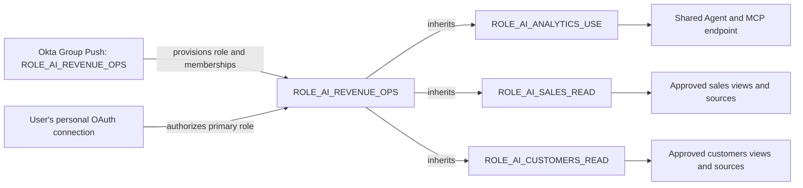

# Scaling roles and permissions for agentic analytics

**Recommendation:** use reusable domain read roles, compose them into approved audience roles, and let Okta manage who belongs to each audience. Each ChatGPT OAuth connection authorizes one audience role that contains its complete approved domain set. Keep the shared Agent/MCP endpoint as the entry point.

**Status as of 2026-10-24:** the personal Snowflake trial demonstrated all-access, sales-only, and customers-only results across fresh OAuth connections for one user. Okta provisioning, separate users, named-role OAuth selection, and production access changes remain untested. Names below describe a proposed design, not deployed production objects. [Observed POC results](pilot_suggestions.md#observed-personal-trial-results-2026-10-24)

## Role layers

| Layer | Example roles | Permissions |
| --- | --- | --- |
| Shared runtime | `ROLE_AI_ANALYTICS_USE` | Agent/MCP `USAGE`, their parent database/schema access, the query warehouse, and `SNOWFLAKE.CORTEX_AGENT_USER`. No domain `SELECT`. |
| Domain read access | `ROLE_AI_SALES_READ`, `ROLE_AI_CUSTOMERS_READ`, `ROLE_AI_NEWSROOM_READ` | Exact approved semantic-view and source-relation `SELECT`, plus required source database/schema access. |
| Audience | `ROLE_AI_SALES`, `ROLE_AI_REVENUE_OPS`, `ROLE_AI_NEWSROOM`, `ROLE_AI_DATA_ENGINEERING` | Inherits shared runtime access and the audience's approved domain roles. This is the OAuth primary role. |

An audience role is a Snowflake account role representing an approved set of analytics permissions. Okta provisions that role through Group Push and assigns its users. The platform deployment process grants the domain/runtime roles into it. Snowflake role inheritance supplies the resulting privileges. [Role inheritance][sf-rbac], [SCIM groups][sf-scim-groups]

Choose domain roles around permission boundaries rather than individual metrics or questions. A role can cover several approved views within a domain. Reuse existing read roles when their complete data surface fits the intended audience; create narrower roles when sensitive subsets need separate approval.

The runtime role must remain independent of data permissions. Granting every domain to that common role would give every audience those domains, regardless of users' other Okta memberships.

## How one multi-domain audience works



The POC's `ROLE_ALL_ANALYTICS_POC` already demonstrates the combined-parent pattern. Its sales and customers child roles provide both domains while OAuth secondary roles remain disabled.

Illustrative inheritance SQL, after the platform-managed child roles exist and Okta has provisioned the audience role:

```sql
GRANT ROLE ROLE_AI_ANALYTICS_USE TO ROLE ROLE_AI_REVENUE_OPS;
GRANT ROLE ROLE_AI_SALES_READ TO ROLE ROLE_AI_REVENUE_OPS;
GRANT ROLE ROLE_AI_CUSTOMERS_READ TO ROLE ROLE_AI_REVENUE_OPS;
```

The child role is granted **to** the parent that should inherit it. These examples do not create production roles or change the POC.

## Example audience profiles

Group Push uses the same group/role name in Okta and Snowflake. Existing organizational groups can feed the identity team's policy for membership in these dedicated analytics groups. [Okta SCIM integration][sf-okta]

| Organizational audience | Proposed pushed group / Snowflake role | Domain read roles inherited, in addition to runtime |
| --- | --- | --- |
| Sales stakeholders | `ROLE_AI_SALES` | Sales |
| Newsroom stakeholders | `ROLE_AI_NEWSROOM` | Newsroom |
| Revenue Operations | `ROLE_AI_REVENUE_OPS` | Sales + Customers |
| Publisher Leadership | `ROLE_AI_PUBLISHER_LEADERSHIP` | Sales + Newsroom, where approved |
| Analytics Engineering | `ROLE_AI_ANALYTICS_ENGINEERING` | Explicitly approved analysis domains |
| Data Engineering | `ROLE_AI_DATA_ENGINEERING` | Explicitly approved analysis domains |

Engineering audiences receive analytics read roles alongside their existing engineering work roles. Keep build, deploy, write, grant-management, and administrative roles outside the ChatGPT audience hierarchy. A job title alone does not approve access to every domain.

An audience role's inherited permissions apply to every member of that audience. If two members need different domain sets, use distinct approved profiles or applicable row/column policies. Additional group memberships do not filter a shared parent role's existing grants.

## Assigned roles versus active roles

The POC user was assigned all three roles, yet the customers-only OAuth session could not retrieve sales. The connection used its authorized primary role with `OAUTH_USE_SECONDARY_ROLES = NONE` and `OAUTH_ANY_ROLE_MODE = DISABLE`. [OAuth controls][sf-oauth]

| Action | Effect in this model |
| --- | --- |
| Assign another audience role to a user through Okta | Makes that role available for authorization; it does not activate it in the existing connection. |
| Grant a domain role to the active audience role | Adds that domain to the audience hierarchy for all members. Verify the resulting access through the client. |
| Change the user's default role | Affects role selection for new default-role OAuth authorizations; the existing connection retains its authorized role. |
| Authorize a different primary role | Requires a new OAuth connection and a fresh chat for a clean test. |

With the current configuration, a user in separate sales and newsroom groups does not automatically receive their union inside one connection. Authorize an approved audience role that includes both domains.

Start with profiles for actual business audiences and recurring access needs. If arbitrary domain combinations become common, evaluate a deterministic aggregation process that produces the appropriate authorized profile and reconciles grants when memberships change. That is additional implementation and must define ownership, approval, removal, and role-selection behavior. Do not create every theoretical combination in advance or assume SCIM already performs this aggregation.

## Selecting the OAuth primary role

| Option | Appropriate use | Status / constraint |
| --- | --- | --- |
| `session:role:all` with an explicitly provisioned `DEFAULT_ROLE` | Stakeholders whose normal Snowflake default can be their analytics audience role | Used by the POC. The scope selects the default role; it does not activate every assigned role. |
| Named scope such as `session:role:ROLE_AI_REVENUE_OPS` | Users who need a different general Snowflake default, including engineers | Documented by Snowflake; ChatGPT's handling of the configured role scope still needs testing. |
| Implicit secondary roles | A different access model that deliberately combines default secondary roles | Outside this proposal. It cannot be combined with the current `ALLOWED_ROLES_LIST` and could activate broader work roles. |

The MCP server can advertise named scopes through `OAUTH_SCOPES_SUPPORTED`, but the client must request the intended scope. Keep the integration allowlist limited to approved audience roles; allowlisting a role does not grant it to a user. Maintain a usable default warehouse. [MCP role selection][sf-mcp], [Role allowlist][sf-oauth]

Select one deterministic analytics profile for each intended connection. Do not choose the profile implicitly based on whichever organizational group was processed most recently. Users should not need to change their default role for each business question.

## Okta and deployment ownership

| Object or change | Proposed owner |
| --- | --- |
| Snowflake application assignment and user lifecycle | IT/Identity through Okta |
| Audience Group Push role lifecycle and user membership | IT/Identity through Okta |
| Runtime and domain read role lifecycle | Data Platform through the reviewed deployment process |
| Object privileges and domain/runtime-to-audience inheritance grants | Data Platform, with domain-owner approval |
| Profile selection, `defaultRole`, and `defaultWarehouse` mappings | IT/Identity, using an agreed profile policy |
| OAuth integration allowlist, client registration, and credential lifecycle | Named Snowflake/ChatGPT integration owners |

Use separate Okta groups for app assignment and Group Push, as Okta requires. Create SCIM-managed audience roles through Push Groups from the beginning; manually created Snowflake roles cannot be adopted into Okta management through ownership transfer. The existing trial roles are therefore examples rather than roles to migrate directly into SCIM ownership. Default-role and warehouse attributes need explicit profile mappings. [App assignment and Group Push][okta-group-push], [Snowflake provisioning constraints][sf-okta]

Assign one owner to each object and membership/grant relationship. Terraform or SQL should not concurrently recreate SCIM-owned audience roles or reconcile their user memberships. Okta should not manage the lifecycle of the platform's domain/runtime roles. Keep the desired inheritance graph reviewed in the deployment repository.

SCIM provisioning and group membership are separate from sign-in and OAuth token issuance. Introducing Okta group management does not by itself require replacing Snowflake OAuth with External OAuth; that authentication choice needs its own design and compatibility test.

## Permission boundaries

- Domain grants cover the full approved views and source dependencies. The managed Agent path needs source access, which can also permit direct source reads outside ChatGPT. It does not enforce named-metric-only access. Resolve the [data-boundary decision](investigation_spike_details.md#critical-gap-access-control-is-not-metric-enforcement) before using real data. [Semantic-view access requirements][sf-semantic-access]
- Use source row-access and masking policies when permissions vary within a domain. Test them under the actual caller roles. Metadata needs separate review: the POC denied data access while still displaying the inaccessible view's name.
- Keep development and production roles, object references, and provisioning targets distinct. Review inherited access, `PUBLIC`, direct user grants, and future grants before interpreting a successful or denied query.
- The Agent's configured tools and ChatGPT plugin audience are additional controls; Snowflake role grants remain the data authorization boundary. Multiple accessible domains do not automatically authorize meaningful cross-domain joins or calculations.

## Adding, changing, and removing access

| Scenario | Required change |
| --- | --- |
| New stakeholder in an existing audience | Provision the user, assign the audience membership, set/verify the connection profile, and run an allowed/denied check. |
| New audience needing existing domains | Create its pushed audience role, grant runtime and approved domain roles into it, update OAuth eligibility, and test a representative user. |
| New domain | Approve sources and semantic definitions, create/reuse its read role, add the Agent resource, and explicitly grant it to the approved audiences. |
| Existing audience gains a domain | Approve the expansion for all audience members, update the hierarchy, and test with an already-connected user. |
| One person changes audience | Reconcile Okta memberships, choose the new profile, and verify the old and new connections cannot retain unintended retrieval. A new profile assignment does not automatically replace the existing connection's primary role. |
| Domain access or user access is removed | Reconcile grants/membership and exercise the explicit Snowflake authorization-revocation procedure where required. Verify existing connections and new sign-ins; measure propagation rather than assuming immediate token invalidation. |

The shared Agent/MCP endpoint can remain in place as audience roles change. Create separate endpoints when ownership or metadata/authentication boundaries require them, rather than making one endpoint per role by default.

## Rollout sequence and acceptance checks

1. Agree the approved domain surfaces, business audiences, owners, and source-exposure contract. Separate ordinary analytics access from administrative workflows.
1. Create runtime/domain roles through the platform process and audience roles through Okta Group Push. Apply the reviewed inheritance graph and configure the intended profile-selection policy.
1. Provision distinct non-production users for a single-domain audience, a multi-domain audience, and an engineer who also has a separate privileged work role.
1. Validate the selected primary role, inheritance, allowed and denied answers, and preservation of access warnings in fresh ChatGPT conversations.
1. Test a group addition, group removal, audience move, refresh, reconnection, and explicit revocation with existing connections. Record the effective role, observed propagation, and available query/run IDs.
1. Approve stakeholder rollout after the target workspace's plugin distribution, source policies, and operating controls pass the [pilot acceptance criteria](pilot_suggestions.md#completion-and-expansion).

| Test case | Required outcome |
| --- | --- |
| Sales audience | Sales queries succeed; customers/newsroom queries are denied unless separately approved. |
| Revenue Operations audience | Sales and customers queries succeed; unrelated domains remain denied. |
| Engineering analytics profile | Approved analysis succeeds; the active profile hierarchy contains no engineering write/admin roles. |
| User assigned several audience roles | The connection follows its explicitly authorized profile; unrelated assigned roles do not become active under the baseline configuration. |
| Audience/domain membership removed | Future retrieval is denied through the tested removal/revocation path, including an existing connection. Previously returned chat content is handled separately. |
| Named-role OAuth selection | The intended analytics role is used while the user's ordinary Snowflake default remains unchanged. Required before adopting that option. |

The personal POC established the basic three-role behavior. These Okta, separate-user, lifecycle, and profile-selection checks are the remaining evidence needed for this scaled design.

[okta-group-push]: https://help.okta.com/oie/en-us/content/topics/users-groups-profiles/app-assignments-group-push.htm
[sf-mcp]: https://docs.snowflake.com/en/user-guide/snowflake-cortex/cortex-agents-mcp#role-behavior-in-oauth-sessions
[sf-oauth]: https://docs.snowflake.com/en/user-guide/oauth-custom
[sf-okta]: https://docs.snowflake.com/en/user-guide/scim-okta
[sf-rbac]: https://docs.snowflake.com/en/user-guide/security-access-control-overview#authorization-through-primary-role-and-secondary-roles
[sf-scim-groups]: https://docs.snowflake.com/en/user-guide/scim-group-api-reference
[sf-semantic-access]: https://docs.snowflake.com/en/user-guide/views-semantic/best-practices-dev
