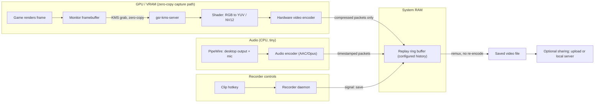

# How Game Capture Works

Notes on how screen and game recording works under the hood. Vice is one example, but most game recorders follow a similar process: capture frames, encode them, buffer or save the result, and optionally share clips. The examples below focus on Linux and Wayland, with implementation details varying by recorder, desktop environment, and GPU.

______________________________________________________________________

## 1. The big idea

A naive recorder would take a screenshot 60 times a second, copy each one into system RAM, and compress it on the CPU. That is slow and expensive: a single 1440p frame is about 15 MB, so 60 fps means roughly 885 MB/s of copying before any compression happens.

Efficient hardware-accelerated recorders aim to follow one rule: **keep the frame on the GPU until it is compressed.** The game already rendered the frame into GPU memory (VRAM). When the capture backend supports it, the recorder grabs a handle to that memory, converts and compresses it with dedicated GPU hardware, and only the small compressed result needs to reach system RAM or the CPU.

______________________________________________________________________

## 2. High-level pipeline



Where the efficiency comes from:

| Stage | The trick | What it avoids |
| -------- | ---------------------------------------------------- | --------------------------------------------------------------- |
| Capture | Read the framebuffer the GPU already has (zero-copy) | Copying ~15 MB per frame to RAM |
| Convert | GPU shader does RGB to YUV | CPU pixel math |
| Encode | Dedicated hardware encoder | Doing video compression on shader cores or the CPU |
| Compress | Inter-frame compression reuses previous frames | Storing every frame in full |
| Buffer | Ring buffer holds compressed packets only | ~106 GB for 2 min of raw frames vs ~230 MB compressed |
| Save | Remux existing packets into a video file | Re-encoding anything when you press the clip hotkey |

______________________________________________________________________

## 3. Capture methods, compared

The main capture paths differ in what they "see."

**Game capture (hooking).** The recorder hooks into the game's graphics API (`Present` in DirectX, a Vulkan layer, `SwapBuffers` in OpenGL). It copies the game's back buffer into a shared GPU texture right before it is shown. Captures only the game, without overlapping windows or desktop notifications. Anti-cheat sometimes objects.

**Compositor / display capture.** Captures the final composited screen. Windows uses the Desktop Duplication API or Windows.Graphics.Capture. Linux uses either:

- **KMS capture**: a privileged helper such as `gsr-kms-server` reads the monitor's scanout framebuffer from the kernel's display subsystem. This provides an efficient capture path, but it records the **whole monitor**, so a terminal placed over the game ends up in the clip.
- **Portal capture**: the app asks `xdg-desktop-portal`, the desktop shows a picker, and the compositor streams frames over PipeWire. DMA-BUFs let supported configurations share GPU buffer handles without copying pixels through system RAM. On GNOME Wayland, this also supports capturing a **single window**. Portal capture generally involves a permission prompt, and a window capture can be tied to that specific window instance.

**Practical rule:** keep the game fullscreen on the captured monitor and other windows elsewhere for clips that show only the game. Use window or game capture when overlapping windows need to stay out of the recording.

______________________________________________________________________

## 4. Encoding and compression

- Encoders want YUV 4:2:0 (NV12), not RGB, so a GPU shader converts each frame first.
- **Hardware encoders**, such as NVIDIA's NVENC, read the converted frame from GPU memory. Supported codecs depend on the GPU generation and recorder.
- **Keyframes (I-frames)** are stored whole. **P/B-frames** store only motion vectors and small corrections relative to other frames ("this block moved 3 px left"). Since consecutive frames are mostly identical, this is where the 100x+ size reduction comes from.
- Higher fps increases capture and encoding work. File size depends on the rate-control settings and scene: fixed-bitrate output stays roughly the same size per second, while quality-based encoding may use more data.

______________________________________________________________________

## 5. Audio and A/V sync

Audio runs on its own path:

- **Desktop audio** comes from PipeWire's monitor of the default output (everything you hear). **Mic** comes from the default input. gpu-screen-recorder can mix them (`-a "default_output|default_input"`) or capture specific apps (`app:<name>`), or everything except one app (`app-inverse:<name>`).
- Audio arrives in small chunks (~10 ms at 48 kHz) and is encoded to AAC or Opus.

Sync works through **timestamps against one shared clock**, not by capturing things together:

1. Every video frame and audio chunk is stamped with the system monotonic clock at capture time.
1. The muxer writes those as presentation timestamps (PTS) and interleaves the packets in time order.
1. On playback, audio is usually the master clock; each video frame is shown when the audio clock reaches its PTS.
1. Sound cards drift slightly from the system clock, so recorders resample audio a tiny bit to stay aligned over long recordings.

Dropped video frames do not break sync, because surviving frames keep their real timestamps. You get a stutter, not drift.

Side effect worth knowing: since desktop audio is "everything you hear," the recorder's own notification tones can get recorded too.

______________________________________________________________________

## 6. The replay buffer

This is the core of an instant-replay recorder.

1. The encoder runs continuously.
1. Compressed packets go into a **ring buffer** in RAM. When it is full, the oldest packets fall off as new ones arrive.
1. Pressing the clip key copies the last N seconds of packets, starting at the nearest keyframe, into an MP4. No re-encoding, so saving is near-instant.

Two settings, two meanings:

| Setting | Meaning |
| ----------------- | ------------------------------------------------- |
| Buffer duration | How far back the recorder can reach (history kept in RAM) |
| Clip duration | How much the clip hotkey saves from that history |

The buffer must be at least as long as the longest clip any hotkey saves. Cost is small: at ~15 Mbps, 2 minutes is ~230 MB of RAM.

______________________________________________________________________

## 7. How a recorder is put together

A recorder often combines several components. Some run in one process; others use a manager around a capture backend such as `gpu-screen-recorder`.

| Component | Role |
| ---------------- | -------------------------------------------------------------------- |
| Recorder daemon | Handles hotkeys, saves clips, and manages recordings |
| Capture backend | Captures frames, encodes video and audio, and maintains replay history |
| Capture helper | Provides privileged display access when the capture method needs it |
| User interface | Configures recording and browses saved clips |
| Sharing service | Optionally uploads clips or serves them through a local server |

**Hotkeys:** some Linux recorders read evdev (raw input devices), which lets them handle keys while a game has focus but requires input-device access. Others use desktop-provided shortcuts. The mechanism and permissions depend on the recorder and desktop.

**Full recordings:** some tools can record a full session while keeping replay history. Depending on the implementation, these may share encoded packets or run separate encodes, so the extra encoder load varies.

**Share links:** tools may upload clips to a hosting service or serve files from the recording PC. For local serving through a tunnel:

1. A local server exposes saved clips.
1. A tunnel provides a public URL that forwards requests to that server.
1. A viewer's request travels through the tunnel to the recording PC, which streams the file back.

With this approach, the PC and sharing service need to stay online, viewing uses the PC's upload bandwidth, and temporary tunnel URLs may change after a restart. Link access controls and embed support depend on the sharing implementation and destination platform.

______________________________________________________________________

## 8. Configuration and performance

Example settings; option names vary by recorder. Replace the display placeholder with a capture source reported by the backend.

```toml
[recording]
display         = "<display-connector>"
fps             = 120
buffer_duration = 120
clip_duration   = 60
```

Performance depends on resolution, frame rate, codec, capture method, and GPU headroom:

- Dedicated encoding hardware reduces competition with the game, but capture, conversion, and memory traffic can still affect game performance.
- A replay buffer and full recording can saturate the encoder if the recorder runs separate encodes. Watch encoder utilization and dropped frames.
- Lowering recording fps reduces capture and encoding work and can leave more headroom.
- Choose recording fps with the intended playback refresh rate in mind. For example, 120 fps divides evenly into 60 Hz playback, while 144 fps does not.

______________________________________________________________________

## 9. Monitoring

```bash
# Replace this placeholder with the recorder's actual user service
RECORDER_SERVICE="<recorder-service>"

# Whole service: memory, CPU time, child processes
systemctl --user status "$RECORDER_SERVICE"

# Current CPU for gpu-screen-recorder, if used (second block is the live sample)
top -b -n 2 -d 2 -p $(pgrep -d, -f "gpu-screen-recorder") | tail -8

# NVIDIA GPU: enc column = hardware encoder load
nvidia-smi dmon -s u

# True cost: compare in-game FPS (MangoHud) with the service running vs stopped
systemctl --user stop "$RECORDER_SERVICE"
```

For recorders managed by a user service, the reported cgroup memory can include cached file writes as well as application memory. Use the GPU vendor's monitoring tools when running on other hardware.

______________________________________________________________________

## 10. Troubleshooting

| Symptom | Cause | Fix |
| ----------------------------- | ------------------------------------------------- | -------------------------------------------------------------------------------------------------------------------------- |
| Clips show the wrong monitor | Backend picked its default capture source | List capture sources (`gpu-screen-recorder --list-capture-options` for that backend) and select the intended monitor |
| Other windows appear in clips | Monitor capture records everything on that screen | Keep other windows off the captured monitor, or use window/game capture where supported |
| Clips lack game labels | Game detection is unavailable or unsupported | Check desktop support and organize clips manually if needed |
| Notification tones in clips | Desktop audio captures everything | Mute recorder notifications or capture only the game's audio |
| Viewer cannot play a clip | Viewer lacks support for the recorded codec | Check the viewer's codec support or use a compatible player |
| Config change not applied | Recorder still running with old settings | Reload settings or restart the recorder's service |
