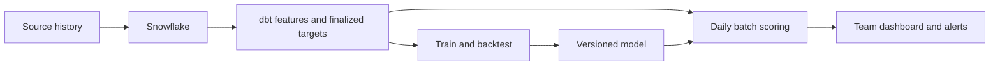

# Event Demand Forecasting for Professional Sports Teams

Think of this as a historical feature pipeline plus a learned estimate of future sales. The practical question is: **given what we know today, how many more tickets will this game sell before it starts?** This is supervised regression: historical examples have known numeric outcomes for the model to learn. All numbers and records below are fictional illustrations, not industry benchmarks.

Start by forecasting primary-market ticket sales under the team's usual pricing and marketing process. Sales are constrained by inventory; estimating unconstrained demand or sales under a different pricing policy requires additional work.

## 1. The Business Problem

Games have fixed dates and limited seats. Unsold inventory expires when the event starts, while strong games can sell scarce inventory too cheaply. An event forecast helps teams act before either problem becomes irreversible.

| Decision | How the forecast helps |
| --- | --- |
| Sales pacing alerts | Flag a game or seating tier projected to finish below its sales goal while there is time to respond. |
| Pricing | Identify where stronger or weaker demand warrants reviewing prices and inventory allocation. |
| Marketing | Prioritize campaigns, group sales, bundles, or promotions for games with a meaningful shortfall. |
| Staffing | Inform staffing and concession planning using expected attendance, not just ticket sales. |

Forecast each price level because an event can have almost-full premium sections and weak upper-bowl sales. For staffing, separately estimate attendance from paid tickets, season-plan allocations, complimentary tickets, and expected no-shows. A sold or transferred ticket does not guarantee someone attends.

## 2. Business Impact

### Catching a slow game early

Suppose 10,000 tickets are available for single-game sales. Three weeks out, 6,000 have sold at an average $50, generating $300,000. Compare two hypothetical paths from that same starting position; remaining sales include both natural demand and campaign results.

| Outcome | Act 21 days out | Act 3 days out |
| --- | ---: | ---: |
| Additional tickets sold before the game | 3,000 | 1,500 |
| Average realized price on those tickets | $45 | $30 |
| Additional ticket revenue | $135,000 | $45,000 |
| Additional campaign cost | $6,000 | $2,000 |
| Total ticket revenue less campaign cost | $429,000 | $343,000 |
| Final tickets sold | 9,000 | 7,500 |

Early action leaves time for group buyers, repeated marketing, and smaller discounts. In this example, the difference is `(3,000 × $45 - $6,000) - (1,500 × $30 - $2,000) = $86,000`. This is not profit and does not establish an actual campaign effect. Account for fees, refunds, variable costs, and buyers diverted from other games; measure real impact against a credible comparison.

### Underpricing a strong game

If 2,000 comparable tickets would sell out at either $40 or $60, selling them all for $40 produces $80,000 instead of $120,000, leaving $40,000 in ticket revenue uncollected. The crucial assumption is that buyers would still purchase all 2,000 at $60. Selling out at $40 alone does not prove that assumption.

## 3. Sell-Through, Pacing, and Forecast Updates

| Concept | Practical meaning |
| --- | --- |
| Sell-through | Net valid paid tickets sold divided by the defined sellable capacity. |
| Sellable capacity | Seats eligible for the sales population, excluding season-plan allocations, comps, and unavailable sections as appropriate. Temporary holds affect immediately available inventory. |
| Price level | A stable seat/product category, such as upper bowl or lower bowl. Its actual price can change over time. |
| Days out | Days between the forecast date and the event date, calculated consistently in the venue's local calendar. |
| Pacing curve | Cumulative net sales plotted against days remaining before the game. |

For an illustrative 10,000-ticket sales pool:

| Days out | Net tickets sold | Sell-through |
| --- | ---: | ---: |
| 60 | 2,000 | 20% |
| 30 | 4,000 | 40% |
| 7 | 6,500 | 65% |
| 0 | 8,000 | 80% |

Compare games at the same days-out checkpoint. A 65% sell-through rate seven days out means something different from 65% sixty days out. Refresh the forecast as actual sales, availability, prices, and known player news change. The remaining-sales estimate should shrink as sales become observed, although a forecast of the final total can move up or down.

Capacity changes need explicit treatment. Opening a section can reduce sell-through without reversing any sales. Keep capacity history and compare consistent inventory pools; transfers and secondary-market resales do not create new primary sales.

## 4. Source Data, Grain, and the Training Table

Every source needs `team_id`, stable business keys, and an observation timestamp. `event_at` records when something happened; `observed_at` records when the warehouse learned it. The examples use local dates for readable days-out calculations; store full timestamps and venue time zones in production. Raw rows are excerpts, while features summarize the complete fictional history. All event rows belong to T01; repeated team and observation columns are omitted from some tables for space.

### Event schedule

| team_id | event_id | event_date | opponent_id | weekday | venue_id | observed_at |
| --- | --- | --- | --- | --- | --- | --- |
| T01 | E101 | 2025-02-18 | O01 | Tuesday | V01 | 2024-09-01 |
| T01 | E102 | 2025-02-22 | O02 | Saturday | V01 | 2024-09-01 |

### Seat inventory snapshots

Here capacity excludes season plans and comps, while temporary holds remain inside the sales pool. Each row reconciles as `capacity = paid_sold + available + held`.

| event_id | price_level | snapshot_date | capacity | paid_sold | available | held |
| --- | --- | --- | ---: | ---: | ---: | ---: |
| E101 | upper | 2025-01-28 | 4,000 | 1,800 | 2,000 | 200 |
| E101 | lower | 2025-01-28 | 3,000 | 2,400 | 500 | 100 |
| E101 | upper | 2025-02-11 | 4,000 | 2,600 | 1,300 | 100 |
| E102 | upper | 2025-02-01 | 4,000 | 3,200 | 750 | 50 |

### Transactions

| transaction_id | event_id | price_level | event_at | observed_at | net_ticket_change | net_revenue_usd |
| --- | --- | --- | --- | --- | ---: | ---: |
| X01 | E101 | upper | 2025-01-20 | 2025-01-20 | 4 | 180 |
| X02 | E101 | upper | 2025-01-23 | 2025-01-23 | -1 | -45 |
| X03 | E101 | lower | 2025-01-25 | 2025-01-25 | 2 | 180 |
| X04 | E101 | upper | 2025-01-27 | 2025-01-30 | 3 | 150 |

Refunds reverse tickets and revenue. X04 must be excluded from January 28 features because it arrived January 30. A voided unpaid order, transfer, or resale is not a new paid primary-market ticket. Deduplicate transaction lines and map each seat to its price level at the relevant time.

### Price changes

| event_id | price_level | effective_at | observed_at | old_price_usd | new_price_usd |
| --- | --- | --- | --- | ---: | ---: |
| E101 | upper | 2025-01-25 | 2025-01-25 | 45 | 50 |
| E101 | lower | 2025-01-10 | 2025-01-10 | 85 | 90 |
| E102 | upper | 2025-01-31 | 2025-01-31 | 50 | 55 |

Keep displayed prices and terms as well as prices paid. Transaction averages omit shoppers who saw an offer and did not buy. Historical scheduled future changes can be used only if their plans were already known at the forecast cutoff.

### Team performance

| team_id | record_as_of | wins | losses | win_pct | observed_at |
| --- | --- | ---: | ---: | ---: | --- |
| T01 | 2025-01-27 | 22 | 18 | 0.55 | 2025-01-27 |
| O01 | 2025-01-27 | 14 | 26 | 0.35 | 2025-01-27 |
| T01 | 2025-01-31 | 24 | 16 | 0.60 | 2025-01-31 |
| O02 | 2025-01-31 | 28 | 12 | 0.70 | 2025-01-31 |

Promotions, marketing exposure, and dated player availability reports are useful additional sources. Store announcements as they were known then, rather than replacing historical expectations with the final lineup.

### Choosing the grain

| Grain | Suitable use | Limitation |
| --- | --- | --- |
| Event | Forecast total single-game sales or attendance. | Hides different seating-tier behavior. |
| Event × price level | Forecast final sales by seating tier at a fixed checkpoint. | Needs a consistent forecast lead time. |
| Event × price level × forecast date | Refresh remaining sales daily or at checkpoints such as 30, 21, and 7 days out. | Rows from the same event are related and must stay together in evaluation. |

Use `(team_id, event_id, price_level, as_of_date)` here. The target is `remaining_net_sales = final_paid_sold_at_event_start - paid_sold_as_of`. Final counts are reconciled after the event but represent ticket status at event start. Future refunds can make the target negative; do not silently remove them.

| event_id | level | as_of_date | days_out | capacity | sold | net_sales_7d | price_usd | home_win_pct | opponent_win_pct | weekend | promo_known | target_remaining |
| --- | --- | --- | ---: | ---: | ---: | ---: | ---: | ---: | ---: | ---: | ---: | ---: |
| E101 | upper | 2025-01-28 | 21 | 4,000 | 1,800 | 300 | 50 | 0.55 | 0.35 | 0 | 0 | 1,200 |
| E101 | lower | 2025-01-28 | 21 | 3,000 | 2,400 | 100 | 90 | 0.55 | 0.35 | 0 | 0 | 300 |
| E101 | upper | 2025-02-11 | 7 | 4,000 | 2,600 | 350 | 50 | 0.58 | 0.40 | 0 | 0 | 400 |
| E102 | upper | 2025-02-01 | 21 | 4,000 | 3,200 | 700 | 55 | 0.60 | 0.70 | 1 | 0 | 800 |

E101 upper finishes at 3,000: `1,800 + 1,200 = 2,600 + 400 = 3,000`. E101 lower finishes at 2,700; E102 upper at 4,000. Targets are future answers for training, unavailable in live scoring. IDs and dates are keys or metadata, not automatically predictors. These four rows illustrate structure, not sufficient training data.

## 5. Feature Engineering

| Feature | Why it can help | Important qualification |
| --- | --- | --- |
| Current sell-through and remaining inventory | Describe the starting position and sales ceiling. | Preserve capacity, holds, and their histories. |
| Net sales in the last 1/7/14 days | Capture current velocity and acceleration. | Use observed transactions and consistently handle refunds. |
| Days out and days since onsale | Describe remaining selling time and how long buyers have had access. | Games with different onsale dates need different pacing expectations. |
| Historical pacing at the same days out | Establish what is normal for similar games. | Build reference curves only from events completed before scoring. |
| Opponent strength and rivalry | Some matchups attract more buyers. | Popularity and rivalry differ from win percentage alone. |
| Expected star availability | Famous players can change interest. | Use dated information, not the actual game-day lineup. |
| Weekday, start time, holidays | Reflect scheduling convenience. | Effects differ across markets and audience segments. |
| Time of season and competing events | Capture opening night, holidays, or local competition. | Use the calendar and announcements known at cutoff. |
| Home record and playoff position | Reflect interest in the team's season. | Final standings would leak future information. |
| Promotions and marketing exposure | Indicate planned offers and recent awareness. | Unannounced future campaigns are unavailable inputs. |
| Current price, price history, seat tier | Distinguish affordability and product value. | Historical price association is not a causal elasticity estimate. |

These are candidates, not a universal ranking. Compare their usefulness on future events. Include missing-data flags; missing player news is different from a confirmed absence. Map categorical inputs such as seat tier consistently between training and scoring.

## 6. How the Models Work

### Baseline: historical pacing curves

Find comparable completed games by team, seating tier, weekday, and matchup. Estimate the typical fraction of final sales already purchased at each days-out checkpoint. This fraction has **final sales** as its denominator, unlike sell-through, which uses capacity.

If comparable games usually have 60% of their final sales by 21 days out, E101 upper's 1,800 tickets imply `forecast_final = 1,800 / 0.60 = 3,000`, or 1,200 additional tickets. At seven days out, a reference fraction of about 86.7% gives `2,600 / 0.867 ≈ 3,000`. Use curves learned only from earlier completed events, and fall back to broader groups when local comparisons are sparse. The ratio method is unreliable near zero sales or immediately after an unusual onsale.

### Gradient boosted trees

A decision tree groups similar rows through questions such as "Is recent sales velocity low?" and "Is this a weekday game?" Each leaf assigns a numerical adjustment. Boosting adds trees sequentially to improve the combined forecast, capturing interactions such as a promotion working differently for weekday upper-bowl inventory. XGBoost and LightGBM are efficient implementations. [XGBoost explanation](https://xgboost.readthedocs.io/en/stable/tutorials/model.html).

```text
predicted_remaining_sales(x) = base_value + learning_rate × sum(tree_m(x))
With squared-error loss: loss = sum((actual_remaining - predicted_remaining)^2)
Training objective = prediction loss + regularization penalty
```

The gradient indicates how changing the forecast would reduce loss; with squared error, new trees learn corrections related to the current residuals, and the central estimate targets the average outcome for similar inputs. XGBoost also uses second-order information about the loss. Depth limits, learning rate, and other hyperparameters control flexibility; validation and early stopping help limit overfitting. [XGBoost paper](https://arxiv.org/abs/1603.02754).

These models suit rows mixing pacing, dates, prices, and matchup context. Numeric scaling is usually unnecessary for tree splits, but categorical encoding must be consistent. LightGBM uses efficient histogram splitting and leaf-wise growth; constrain complexity when there are few independent games. [LightGBM features](https://lightgbm.readthedocs.io/en/stable/Features.html).

### Comparison with classic time series methods

Exponential smoothing weights recent observations more heavily and can model trend and seasonality. ARIMA models relationships with past values and past forecast errors, often after differencing; versions can include seasonal structure and external inputs. They are useful benchmarks for regularly spaced daily sales series. [statsmodels time series methods](https://www.statsmodels.org/stable/tsa.html).

Event sales have changing onsale dates, matchups, and remaining lifetimes. Trees can learn across many events using those attributes directly; time series methods can also use external inputs or model individual booking curves. Compare both against the pacing baseline at the actual forecast horizons rather than assuming one family always wins.

## 7. Training and Evaluation

### Replay the past without future information

Train on earlier completed events, tune settings on a later validation period, and reserve the newest period as an untouched test. For example, fit on seasons 1 and 2, validate on season 3, and test on season 4. Every training target must have been finalized before the forecast date being replayed. Keep all price levels and snapshots of the same event in the same partition.

Backtesting repeatedly advances the forecast date and evaluates what the system would have predicted then. Compare errors at 60, 30, 21, and 7 days out separately; a model useful three days out may provide little early warning. Avoid letting events with more snapshots dominate evaluation, and keep reference curves and learned preprocessing inside the training period. [Rolling forecast evaluation](https://otexts.com/fpp3/toolbox.html#time-series-cross-validation).

Point-in-time correctness applies to transactions, inventory, prices, performance, and news. A concrete leakage example: an injury is announced February 10, but a historical January 28 row joins today's player-status table and sees "out." The model appears to anticipate a sales slowdown using information that did not exist then. Final standings, future discount decisions, and X04's late arrival create similar leakage.

### Metrics

Let `y` be actual remaining net sales and `f` the forecast. Evaluate the same target and lead time for all candidate models.

| Metric | Calculation | Practical interpretation |
| --- | --- | --- |
| MAE | `mean(abs(y - f))` | Average miss in tickets, easy for operators to understand. |
| MAPE | `100 × mean(abs(y - f) / abs(y))` | Average percentage miss; undefined at zero actual sales and unstable near zero. |
| WAPE | `100 × sum(abs(y - f)) / sum(abs(y))` | Aggregate error relative to actual volume; larger games dominate and an all-zero denominator is undefined. |
| Bias | `mean(f - y)` | Positive means systematic overforecasting; negative means underforecasting. |

For actual values `[1,200, 300, 800]` and forecasts `[1,000, 400, 900]`, absolute errors are `[200, 100, 100]`: MAE is 133.3 tickets, MAPE is 20.8%, and WAPE is `400 / 2,300 = 17.4%`. Use MAE by game/tier and horizon, supported by WAPE and bias across the portfolio. WAPE can change with the mix of games, so compare identical evaluation sets. [MAE](https://scikit-learn.org/stable/modules/generated/sklearn.metrics.mean_absolute_error.html), [MAPE](https://scikit-learn.org/stable/modules/generated/sklearn.metrics.mean_absolute_percentage_error.html), [WAPE limitations](https://robjhyndman.com/hyndsight/wape.html).

### Prediction intervals and decisions

A point forecast of 1,200 additional tickets with an 80% prediction interval of 500 to 1,900 communicates a much wider range than 1,100 to 1,300. For E101 upper, the first interval implies 2,300 to 3,700 final sales. A marketing push or staffing commitment should consider that range and the different costs of over- and underestimating.

One approach is quantile regression: predict the 10th and 90th percentiles rather than only a central estimate. On later held-out events, check that the interval contains outcomes about 80% of the time and that its width is useful. Check coverage by days out and team; an arbitrarily wide interval is not operationally helpful. Correct crossed interval bounds and re-evaluate any capacity adjustments. [Gradient boosting prediction intervals](https://scikit-learn.org/stable/auto_examples/ensemble/plot_gradient_boosting_quantile.html).

## 8. Demand Forecasting and Price Optimization

Forecasting estimates future purchases; optimization chooses a permitted price or action to meet a revenue objective. A forecast under historical pricing behavior can support pacing alerts, but price optimization additionally needs reliable estimates of demand at alternative prices.

**Price elasticity** is percentage change in demand divided by percentage change in price, holding other influences comparable. If a 10% price increase causes demand to fall 20%, elasticity is approximately -2. It can differ by game, seat tier, and time remaining.

The causal trap is simple: popular games both attract more buyers and get higher prices. Historical data can therefore show higher prices alongside higher sales, even when raising the price of the same offer would reduce purchases. This is price endogeneity, caused by demand factors influencing pricing decisions. A predictive model and SHAP cannot resolve it by themselves. [Research addressing price elasticity and endogeneity](https://arxiv.org/abs/2208.03135).

Use carefully designed price experiments or credible causal methods to estimate price response, accounting for substitution across tiers and games. As a simplified single-period calculation, `revenue(p) = p × min(remaining offered capacity, demand(p))`; a fuller policy also considers later buyers, offer costs, and inventory allocation. Changing the model's price input alone does not establish what a price change will cause.

## 9. Explaining a Forecast with SHAP

SHAP, or SHapley Additive exPlanations, distributes a prediction's difference from a reference among its features. Intuitively, it averages how much revealing each feature changes the prediction across different combinations of the other features. [Original SHAP paper](https://arxiv.org/abs/1705.07874).

For a direct ticket-count regression model, a fictional E101 upper explanation could be:

| Component | Contribution to remaining-sales forecast |
| --- | ---: |
| Reference prediction | 1,800 tickets |
| Tuesday scheduling | -250 |
| Low opponent win percentage | -200 |
| Recent sales behind reference pace | -300 |
| Other features combined | +150 |
| Final prediction | 1,200 tickets |

The ticketing director sees: "Forecast is lower because this is a Tuesday matchup with a low-record opponent and recent sales are below comparable pace." Present observed feature values, comparison group, and forecast date alongside the reasons. These explain model associations, not true motives or guaranteed effects of changing a price. [SHAP TreeExplainer](https://shap.readthedocs.io/en/latest/generated/shap.TreeExplainer.html).

SHAP contributions add in the model's explained output units. Ticket units apply to this direct regression example; a log-transformed target, separate calibration, or post-forecast clipping requires a clearly identified explanation of the appropriate output.

## 10. Productionizing the Forecast

Daily snapshots or complete CDC history preserve sold seats, availability, holds, and effective prices. Today's inventory only shows today's state. Transactions alone can reconstruct sales with a complete ledger, but cannot recover historical capacity, holds, displayed prices, or deleted state changes. Daily snapshots support daily pacing; CDC supports finer reconstruction. Starting either now cannot recover history that was never captured. [dbt snapshots](https://docs.getdbt.com/docs/build/snapshots).



1. **Build:** dbt staging models standardize keys and deduplicate records. Intermediate models reconstruct each cutoff; aggregate sources to event-level/tier-level features before joining to avoid row multiplication. Use the same feature definitions in training and scoring, and keep targets separate from live inputs.
1. **Train:** Airflow orchestrates a Python training job or supported Snowflake runtime. Compare the pacing baseline with tree models, evaluate intervals, and save features, preprocessing, model settings, dependencies, and metrics together.
1. **Score:** Build today's features and run a pinned model version in Python or supported Snowflake batch inference. Scoring can run daily while retraining waits for enough completed events. [Snowflake batch inference](https://docs.snowflake.com/en/developer-guide/snowflake-ml/inference/native-batch-inference-sql).
1. **Deliver:** Publish sold-to-date, remaining-sales forecast, projected final sales, interval, sales-goal gap, and main reasons by event/tier. Include cutoff, freshness, and model version; make delivery repeatable without duplicate alerts.
1. **Monitor:** Check unique keys, inventory reconciliation, feed lag, price coverage, forecast revisions, and forecast bounds. Preserve original forecasts and compare them with finalized actuals by team, tier, and days out throughout the season.

For a stable inventory pool, final sales must stay between zero and capacity; forecast refunds can reduce the sold-to-date total. If sections may open, model that allocation explicitly. Ensure tier forecasts reconcile to the event total, but do not assume summing tier interval bounds gives the intended event-level coverage because tier sales are related. Stop or flag publication when critical inventory feeds are stale instead of treating missing activity as zero demand.

Monitor data drift, which is changing inputs, and concept drift, which is a changing relationship between inputs and sales. Track MAE, WAPE, bias, interval coverage, and width once labels mature. Log pricing and campaign actions too: they change observed sales and can make a correct warning look like an inaccurate forecast after the team successfully intervenes.

## 11. Domain Pitfalls and Cross-Team Learning

| Situation | Practical response |
| --- | --- |
| New team with no local history | Use a simple pooled baseline with wide, validated uncertainty, then adapt as completed games accumulate. |
| New arena or seating map | Remap tiers, capacity, and product quality; do not assume old prices and curves transfer unchanged. |
| Playoff race or sudden popularity | Use standings/news known at cutoff and evaluate unusual seasons separately. |
| Star injury or uncertain participation | Update from dated reports; show scenario ranges when availability remains unresolved. |
| Sellout | Recorded sales cap at inventory; selling 4,000 does not reveal whether 4,100 or 8,000 buyers wanted tickets. This is censored demand. Flag sellouts and preserve waitlist or unsuccessful-purchase evidence. |
| Changing promotions or pricing | Record the operating policy; historical sales already reflect those interventions. |
| Season plans, comps, transfers, and resale | Keep ticket-sales populations and attendance measures distinct, and avoid counting the same seat twice. |

Pooling authorized teams' data can reveal shared patterns in weekday sales, lead time, and matchup interest. Normalize by comparable capacity and product definitions; validate future seasons per team and hold out entire teams if claiming performance on new teams. Many snapshots from one game do not create many independent examples of a playoff race.

Each team still owns its data. Obtain explicit authorization for cross-team training, isolate raw records and outputs, and restrict training roles to the approved use. Team A should see its forecasts and explanations, not Team B's underlying records. A shared model can learn common patterns without exposing holder identities; data isolation alone does not automatically eliminate every disclosure risk from model artifacts.

## 12. Glossary

### Data and learning

| Term | Plain-language meaning |
| --- | --- |
| Machine learning / model | Learning patterns from examples; the model is the saved system that applies those patterns. |
| Supervised learning / regression | Learning from known answers; regression predicts a number, such as remaining ticket sales. |
| Feature / predictor / input | A value known when forecasting, such as recent sales or days out. |
| Feature engineering | Turning source records into useful inputs with consistent definitions. |
| Target / label | The future answer used to teach or evaluate the model. |
| Training example / grain | One learning row and what it represents, here one event, tier, and forecast date. |
| Categorical input / encoding | A category such as seat tier, represented in a format the model supports. |
| Missing-data flag | An input indicating that another value is unavailable, rather than truly zero. |
| Scaling / normalization | Expressing values in comparable units or fractions, such as sales relative to capacity. |
| Preprocessing | Transformations applied to inputs before learning or prediction. |
| Training / fitting | Learning the model from feature rows and their known targets. |
| Scoring / inference / batch scoring | Applying the learned model; batch scoring processes many event rows together. |
| Training set | Examples used to fit the model. |
| Validation set | Separate examples used to select settings and stopping points. |
| Test set / held-out data | Examples excluded from development decisions to assess the finished model. |
| Time-based split / partition | Dividing examples into earlier development data and later evaluation data. |
| Backtesting / rolling evaluation | Replaying historical forecast dates using only knowledge available at those dates. |
| Forecast horizon / lead time | How far into the future the prediction reaches, such as 21 days until the game. |
| Point-in-time correctness | Reconstructing only what the system could actually have known at a forecast cutoff. |
| Data leakage | Letting future answers or unavailable information influence model development or evaluation. |
| Finalized / mature label | An outcome ready for use after the event and necessary reconciliation have finished. |
| Independent examples | Cases providing distinct evidence; repeated snapshots of one game are related, not independent games. |

### Models and time series

| Term | Plain-language meaning |
| --- | --- |
| Baseline / reference group | A simple comparison method and the similar historical games used to establish expectations. |
| Pacing curve | Cumulative sales at different amounts of time before an event. |
| Decision tree / split / leaf | Learned questions divide rows into groups; the terminal group, or leaf, supplies a score. |
| Ensemble / boosting | Combining models; boosting adds models sequentially to improve their combined forecast. |
| Gradient boosted trees | Trees added using information about how to reduce the current prediction error. |
| XGBoost | An efficient library for gradient boosted trees, short for Extreme Gradient Boosting. |
| LightGBM | An efficient boosted-tree library with histogram splitting and leaf-wise growth. |
| Histogram splitting / leaf-wise growth | Grouping values into bins to find splits efficiently; growing the leaf with the best improvement next. |
| Interaction | One feature's predictive effect depends on another, such as promotions behaving differently by seating tier. |
| Base value | The starting prediction before adding tree adjustments, or an explanation's reference prediction. |
| Learning rate | How much each new tree's contribution is shrunk before being added. |
| Residual | Actual outcome minus the current prediction, expressing what remains unexplained. |
| Loss / squared error | A measure of prediction error; squared error squares each miss, emphasizing larger misses. |
| Objective / regularization | What training minimizes; regularization adds penalties or constraints to discourage excessive complexity. |
| Gradient | How loss changes when a prediction changes, indicating a useful correction direction. |
| Second-order information / Hessian | How the gradient changes; it helps estimate useful tree adjustments. |
| Hyperparameter / tree depth | A chosen training setting; depth limits the number of successive decisions inside a tree. |
| Early stopping | Ending training when additional trees stop improving validation performance. |
| Overfitting | Learning historical details that do not help predict new events. |
| Time series | Measurements ordered through time, such as daily ticket sales. |
| Trend / seasonality | Long-term movement and recurring patterns such as weekly or annual cycles. |
| Exponential smoothing | Forecasting with declining weights on older observations, potentially including trend and seasonality. |
| ARIMA | Autoregressive Integrated Moving Average, a family using past values and past errors, with differencing when needed. |
| Differencing | Subtracting a previous observation to model changes instead of raw levels. |
| External input | A known contextual variable added to a time series model, such as promotion timing. |

### Evaluation, decisions, and operations

| Term | Plain-language meaning |
| --- | --- |
| Metric | A numerical measure of forecast quality or business outcomes. |
| MAE | Mean Absolute Error, the average size of the miss in ticket units. |
| MAPE | Mean Absolute Percentage Error, the average percentage miss; problematic at zero or tiny actuals. |
| WAPE | Weighted Absolute Percentage Error, total absolute error divided by total absolute actual volume. |
| Bias | Average forecast minus actual; its sign indicates systematic over- or underprediction. |
| Point forecast / uncertainty | One central estimate and the range of outcomes that may occur around it. |
| Prediction interval / width | A range intended to contain a stated fraction of future outcomes; width is its upper bound minus lower bound. |
| Quantile / percentile | A predicted cutoff below which a specified share of outcomes falls, such as the 90th percentile. |
| Quantile regression | Learning those conditional cutoffs directly rather than only the average outcome. |
| Coverage / calibration | How often intervals contain actual outcomes, and whether that agrees with the stated coverage level. |
| Optimization | Choosing the allowed action expected to best achieve an objective, such as revenue. |
| Price elasticity | Percentage change in demand caused by a percentage change in price, under comparable conditions. |
| Causal effect / price endogeneity | An action's effect on outcomes; price endogeneity occurs when demand influences prices, confusing observed associations. |
| Experiment | A designed comparison, often randomized, used to estimate the effect of an action. |
| SHAP / Shapley contribution | SHapley Additive exPlanations; a feature's averaged contribution to the prediction relative to a reference. |
| Explainability | Describing the model's reasons for a forecast without claiming those reasons prove causation. |
| Log-transformed target | Learning the logarithm of an outcome rather than its original units; explanations require the correct output scale. |
| Clipping / forecast bounds | Restricting an output to valid limits, such as zero through sellable capacity. |
| Snapshot / CDC | A saved state at a moment; change data capture records state changes over time. |
| Model artifact / version | A saved model package and the identifier distinguishing it from other packages. |
| Retraining | Fitting a new model after more outcomes or justified changes become available. |
| Data drift / concept drift | Changing inputs versus a changing relationship between inputs and future sales. |
| Pooled model | A shared model trained on multiple authorized teams' examples. |
| Censored demand | Sales hide part of demand because buyers cannot purchase beyond available inventory. |
