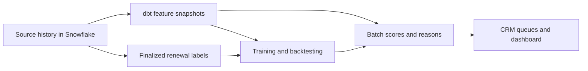

# Season Ticket Holder Renewal Risk Modeling

Think of this as a feature pipeline plus a learned risk score. The question is: **given what we know today, which season ticket accounts are most likely not to renew next season?** Historical behavior and known renewal outcomes teach the model to predict churn.

All records, scores, and revenue figures below are fictional examples. Renewal rules, pricing, and useful signals vary by team.

## 1. The Business Problem

Renewals give teams a reliable revenue base and reduce the inventory they must sell game by game. Retained accounts can add seats, upgrade packages, and refer buyers. A lost account's financial impact depends on whether the team can replace it and at what cost.

Renewal campaigns can start during the current season. Some teams require confirmation and a deposit; others automatically renew unless the holder opts out. Payment plans and seat-change windows affect what counts as a completed renewal. [Example renewal process](https://dream.wnba.com/auto-renewal).

| Stage | Team activity | Model's role |
| --- | --- | --- |
| Before renewal launch | Resolve service problems and prepare next-season quotes. | Spot declining engagement before the deadline rush. |
| Renewal window | Reps call unresolved accounts and discuss concerns. | Focus limited outreach on likely non-renewers. |
| After the deadline | Reconcile payments, cancellations, and exceptions. | Assign final outcomes and evaluate results. |

A **holder** means the purchasing account, not every attendee. The example scores unresolved, eligible 2024-25 full-season accounts for renewal into 2025-26. Features use information available before February 1, 2025 at 00:00 UTC. The deadline is April 15, with outcomes finalized April 30 after reconciliation.

The label is `churned_next_season = 1` for non-renewal and `0` for a valid commitment meeting payment rules. An automatic invoice alone may not qualify. Renewing fewer seats retains the account but loses revenue; track that separately. Define how smaller-package renewals and unresolved cases are handled.

Reps receive risk, account value, and a few clear reasons. They can discuss scheduling, seat location, transfers, payment plans, service fixes, or appropriate save offers. Record contacts, actions, offer costs, and outcomes in the CRM, and stop outreach once an account renews or becomes ineligible.

**High risk does not mean easy to save.** Someone moving away may be certain to leave; someone unhappy with their seat may respond to a simple change. The model finds likely non-renewers. A controlled campaign measures whether outreach changes their decisions.

## 2. Business Impact

Assume 5,000 eligible accounts averaging $6,000 per season. Hold price and package size constant to isolate the renewal effect.

| Measure | Existing process | Improved process |
| --- | ---: | ---: |
| Renewal rate | 82% | 85% |
| Renewed accounts | 4,100 | 4,250 |
| Non-renewed accounts | 900 | 750 |
| Retained ticket revenue | $24,600,000 | $25,500,000 |

```text
Additional renewals = 5,000 × (0.85 - 0.82) = 150
Additional retained ticket revenue = 150 × $6,000 = $900,000
```

That is a 3 percentage point renewal improvement. If added outreach costs $15,000 and incentives cost $90,000 across all redemptions, the simplified benefit is `$900,000 - $15,000 - $90,000 = $795,000` before other costs and replacement-sales effects. Offers used by people who would have renewed anyway still count as costs.

For example, contacting 1,000 selected accounts and improving their renewal rate by 15 points would produce those 150 extra renewals. That effect needs experiment evidence; accurate scores alone do not establish saved revenue. Use actual retained package value and account for seats that would otherwise sell to new buyers.

## 3. Example Sources and the Training Table

All account records belong to T01 and the current season is 2024-25. Join using team-qualified keys. `event_at` is when something happened; `observed_at` is when the warehouse learned it. Preserve both and historical versions of changing records. Repeated team and timing fields are omitted from some tables for space.

These are source excerpts. Final features summarize the complete fictional history: 20 included home games had finished before scoring, giving two-seat holders 40 eligible tickets and the four-seat holder 80.

### Ticket purchases

| purchase_id | holder_id | season_id | seats | plan_value_usd | purchased_at |
| --- | --- | --- | ---: | ---: | --- |
| P101 | H101 | 2024-25 | 2 | 6,000 | 2024-04-10 |
| P102 | H102 | 2024-25 | 2 | 4,800 | 2024-08-15 |
| P103 | H103 | 2024-25 | 4 | 12,000 | 2024-03-05 |

These amounts are package commitments. Keep installments and refunds separately so the same plan is not counted repeatedly.

### Plan holders

| holder_id | first_season | account_type | seat_tier | rep_id |
| --- | --- | --- | --- | --- |
| H101 | 2021-22 | individual | lower_bowl | R07 |
| H102 | 2024-25 | individual | upper_bowl | R12 |
| H103 | 2018-19 | corporate | club | R07 |

Tenure is four, one, and seven seasons, counting the current season. Keep old account versions so later status or seat changes do not rewrite historical features.

### Gate scans

| scan_id | ticket_id | scanning_account_id | event_at | result |
| --- | --- | --- | --- | --- |
| S001 | K101_G01_A | H101 | 2024-10-23 23:05 | accepted |
| S003 | K102_G01_A | G900 | 2024-10-23 23:12 | accepted |
| S004 | K102_G01_A | G900 | 2024-10-23 23:13 | duplicate_rejected |

Count distinct eligible tickets with an accepted scan, not attempts. G900 is a guest using H102's ticket: that proves ticket use, not attendance by the purchaser. Ownership comes from the ticket entitlement history.

### Resale and transfers

| activity_id | ticket_id | original_holder_id | activity_type | event_at | sale_usd |
| --- | --- | --- | --- | --- | ---: |
| A001 | K102_G01_A | H102 | transfer_accepted | 2024-10-22 | NULL |
| A002 | K102_G10_A | H102 | resale_listed | 2024-12-01 | NULL |
| A003 | K102_G10_A | H102 | resale_completed | 2024-12-03 | 45 |

Listings and completed sales are different signals. Transfers can be healthy sharing. Sold or transferred tickets can also be scanned, so these rates overlap.

### In-venue spending

| transaction_id | linked_holder_id | game_id | category | amount_usd | event_at |
| --- | --- | --- | --- | ---: | --- |
| V001 | H101 | G01 | concessions | 38 | 2024-10-23 23:40 |
| V003 | H103 | G20 | merchandise | 95 | 2025-01-29 00:35 |
| V004 | NULL | G20 | concessions | 24 | 2025-01-29 00:40 |

Use supported identity matches. Missing purchase coverage is different from no spending, and venue spending does not necessarily all belong to the team.

### App and email engagement

| engagement_id | holder_id | event_type | event_at | observed_at |
| --- | --- | --- | --- | --- |
| E001 | H101 | app_session | 2025-01-30 | 2025-01-30 |
| E002 | H101 | email_click | 2025-01-25 | 2025-01-25 |
| E003 | H102 | app_session | 2025-01-02 | 2025-01-02 |
| E006 | H102 | app_session | 2025-01-31 | 2025-02-03 |

E006 arrived after scoring, so it cannot enter February 1 features. H102's last observed app session remains January 2, or 30 days earlier. Use meaningful activity such as clicks and active days; privacy features and automated activity can distort email opens.

### Supporting data and later outcomes

A schedule and entitlement ledger identify each holder's tickets for completed, included games. Exclude future or canceled games and invalid entitlements from scan-rate denominators. Preserve original ownership after transfers.

The quotes below were known before scoring; the renewal outcomes become usable as labels only after April 30. Compare the same package when calculating price increases.

| holder_id | current_value_usd | next_quote_usd | quote_known_on | qualifying_renewal_at | churned_next_season |
| --- | ---: | ---: | --- | --- | ---: |
| H101 | 6,000 | 6,600 | 2025-01-20 | 2025-04-10 | 0 |
| H102 | 4,800 | 5,520 | 2025-01-20 | NULL | 1 |
| H103 | 12,000 | 12,600 | 2025-01-20 | 2025-03-05 | 0 |

### Final training table

The grain is one row per `(team_id, holder_id, season_id)` at the February 1 cutoff. Rates are fractions; `scan_change_pp` is January usage minus the earlier-window rate in percentage points. Spend covers the observed season to date; app and click counts cover the last 30 days.

| holder_id | season_id | tenure | plan_value_usd | scan_rate | scan_change_pp | resale_rate | transfer_rate | price_change_pct | linked_spend_usd | app_active_days_30d | email_clicks_30d | days_since_app | churned_next_season |
| --- | --- | ---: | ---: | ---: | ---: | ---: | ---: | ---: | ---: | ---: | ---: | ---: | ---: |
| H101 | 2024-25 | 4 | 6,000 | 0.80 | -40 | 0.10 | 0.20 | 10 | 450 | 8 | 4 | 2 | 0 |
| H102 | 2024-25 | 1 | 4,800 | 0.25 | -20 | 0.50 | 0.15 | 15 | 80 | 1 | 0 | 30 | 1 |
| H103 | 2024-25 | 7 | 12,000 | 0.90 | 0 | 0.05 | 0.60 | 5 | 1,600 | 15 | 7 | 1 | 0 |

H102 used 10 of 40 tickets, sold 20, and transferred 6. H101 used 20 of 20 tickets earlier and 12 of 20 in January: cumulative usage is 80%, with a 40-point drop from 100% to 60%. That drop is also 40% relative to the earlier rate.

IDs and season are metadata; churn is the label. Select input columns explicitly. Keep opportunity counts and missing-data flags in a fuller dataset. Three rows explain the structure but cannot train a useful model.

## 4. Feature Engineering

| Candidate feature | Why it can help | Main caution |
| --- | --- | --- |
| Scan rate | Measures value the account gets through ticket use. | Distinguish ticket use from the holder's attendance. |
| Recent usage decline | Finds a change hidden by the season average. | Compare similar windows and keep denominator counts. |
| Consecutive unused games | Detects sustained absence. | Use games included in that account's plan. |
| Resale volume and success | Can show disengagement or useful cost recovery. | Separate listings, sales, and failed listings. |
| Transfers and use after transfer | Shows whether sharing keeps the plan useful. | High transfers may be normal for corporate accounts. |
| Tenure and first-year status | Reflect history and relationship length. | Missing prior history is not zero engagement. |
| Known price increase | Can signal affordability or reduced value. | Compare the same package and use a pre-cutoff quote. |
| Payment and service problems | Reveal concerns a rep may be able to resolve. | Exclude later renewal payment results and save offers. |
| Linked spend and digital activity | Add evidence of engagement or decline. | Track identity coverage and source availability. |
| Plan type and team context | Account for different usage and known performance. | Future standings or playoff outcomes would leak. |

These are candidates, not a guaranteed importance ranking. Test them on later seasons. Rates compare different package sizes, but keep counts: 50% usage from two tickets carries less evidence than 50% from eighty. With no eligible games, the rate is undefined rather than 0%.

## 5. How Gradient Boosted Trees Work

A decision tree asks learned questions, such as whether scan rate is below 40%, then assigns a score to each terminal group, or leaf. One tree might capture low usage; another might capture how price increases matter for first-year holders.

Boosting builds trees sequentially. Each new tree improves the combined predictions already built. XGBoost and LightGBM implement this efficiently. [XGBoost introduction](https://xgboost.readthedocs.io/en/stable/tutorials/model.html).

```text
Raw score: z(x) = base_value + learning_rate × sum(tree_m(x))
Churn probability: p(x) = 1 / (1 + exp(-z(x)))
Binary log loss: L(y, p) = -[y × ln(p) + (1 - y) × ln(1 - p)]
Training objective = prediction loss + regularization penalty
```

The sigmoid converts raw log odds into a probability. Log loss penalizes confident mistakes: predicting 1% risk for an actual churner is worse than predicting 40%. The gradient shows how to adjust scores to reduce loss; here it is `p - y`. For a churner predicted at 0.20, it is -0.80, indicating the score needs to rise. XGBoost also uses second-order information, called the Hessian. [XGBoost paper](https://arxiv.org/abs/1603.02754).

Learning rate shrinks each tree's contribution. Depth limits and regularization discourage overly complex rules; early stopping ends training when validation results stop improving. These settings are hyperparameters.

Trees suit tabular data because they handle nonlinear patterns and interactions, such as price increases mattering differently by tenure. Numeric standardization is usually unnecessary, but categories and missing values need consistent handling. Compare boosted trees with a scan-rate rule and logistic regression before accepting the added complexity.

## 6. Training and Evaluation

### Split by season and replay earlier campaigns

| Dataset | Example seasons | Purpose |
| --- | --- | --- |
| Training | 2020-21 and 2021-22 | Learn from finalized outcomes. |
| Validation | 2022-23 | Choose features, settings, and outreach rules. |
| Calibration | 2023-24 | Fit a probability adjustment on separate predictions. |
| Final test | 2024-25 | Evaluate the finished package on a later season. |

Use comparable points in each team's renewal cycle. Every training label must have been finalized before the scoring date being replayed. Keep learned transformations and reference statistics out of test data. Backtesting repeats this across historical seasons to check whether results hold up.

Returning holders may appear in earlier training seasons and later test seasons if that matches deployment. Exclude holder IDs as predictors and evaluate first-year accounts separately. If scoring at several dates, keep the same season's snapshots together rather than splitting randomly.

### Point-in-time correctness and leakage

Suppose H102 is scored February 1, requests non-renewal March 10, and gets a CRM status of "not renewing" March 11. Joining February features to today's account record reveals the later answer. Join the version available before February 1 instead. Future purchases, final attendance, and post-cutoff discounts cause similar leakage. [Common leakage mistakes](https://scikit-learn.org/stable/common_pitfalls.html).

Check event and observation times. January activity received in February was unavailable to January scoring. Preserve source versions and frozen features so later backfills do not silently improve historical evaluations.

### Class imbalance and metrics

With 18% churn and 82% renewal, predicting renewal for everyone gives 82% accuracy while finding no churners. Start with the real distribution; consider class weights if needed, and check calibration. Any oversampling or undersampling belongs only in training.

| Metric | What it tells the retention team |
| --- | --- |
| Accuracy | Share of correct binary decisions; can hide missed churn under imbalance. |
| ROC-AUC / AUC | How well scores rank churners above renewers across the population; 0.5 is random ranking. |
| Precision | Share of selected accounts that actually churned. |
| Recall | Share of all churners that were selected. |
| Precision at top K | Risk concentration among the K accounts reps can contact. |
| Recall at top K | How much churn that capacity catches. |
| Lift at top K | Precision at K divided by the overall churn rate. |
| Calibration | Whether predicted probabilities match observed churn frequencies. |

For the 5,000-account example, suppose the highest-risk 1,000 contain 550 of the 900 churners:

| Actual outcome | Selected | Not selected |
| --- | ---: | ---: |
| Churned | 550 | 350 |
| Renewed | 450 | 3,650 |

```text
Precision@1000 = 550 / 1000 = 55%
Recall@1000 = 550 / 900 = 61.1%
Lift@1000 = 55% / 18% = 3.06×
```

The list concentrates risk about three times better than random selection, but misses 350 churners. Increasing K usually trades concentration for coverage; use rep capacity rather than assuming a 0.50 cutoff. AUC needs the ranked scores, not just this table. [AUC](https://scikit-learn.org/stable/modules/generated/sklearn.metrics.roc_auc_score.html), [precision](https://scikit-learn.org/stable/modules/generated/sklearn.metrics.precision_score.html), [recall](https://scikit-learn.org/stable/modules/generated/sklearn.metrics.recall_score.html).

**Precision at rep capacity is the main offline metric. Incremental renewals and net retained revenue are the business metrics.** A good ranking can still deliver few saves if selected holders cannot be retained. Compare with existing rep rules and measure campaign impact against a control group.

Among holders scored near 30% risk, about 30% should churn. If only 10% churn, the model overstates risk even if its ranking is useful. Fit calibration on data separate from the base-model fit. Platt scaling uses a sigmoid mapping; isotonic regression uses a more flexible monotonic mapping and needs enough data. [Probability calibration](https://scikit-learn.org/stable/modules/calibration.html).

`calibrated_risk × account_value` estimates revenue at risk, not revenue outreach will save. Action value depends on the increase in renewal probability caused by outreach, called uplift, minus contact and offer costs. Estimate that effect through treatment/control evidence.

## 7. Explainability with SHAP

SHAP, or SHapley Additive exPlanations, assigns each feature a contribution relative to a reference prediction. Imagine revealing features in different orders and averaging how much each changes the result. Positive contributions raise predicted churn; negative ones lower it. [SHAP introduction](https://shap.readthedocs.io/en/latest/example_notebooks/overviews/An%20introduction%20to%20explainable%20AI%20with%20Shapley%20values.html).

A fictional raw-score explanation for H102:

| Component | Log-odds contribution |
| --- | ---: |
| Reference score | -1.52 |
| Low ticket usage | +1.20 |
| First-year tenure | +0.50 |
| 15% price increase | +0.40 |
| Other features combined | +0.52 |
| Final score | 1.10 |

`sigmoid(1.10) ≈ 75%` churn risk before any separate calibration. Contributions are log odds, not percentage points. The reference is defined by the explanation method, not automatically the team's churn rate. [TreeExplainer units](https://shap.readthedocs.io/en/latest/generated/shap.TreeExplainer.html).

A rep could see: "Elevated risk: only 10 of 40 tickets used, first-year membership, and a 15% price increase." Show the score date and supporting values. For H101, a reason could say: "Ticket usage fell 40% relative to the earlier window, from 100% to 60%." Call it a risk driver only if it actually raises that holder's model score.

SHAP explains model behavior, not true motives or which offer will work. Related features can share attribution, and a separate calibrator changes what the raw explanation sums to. Use reasons to guide conversations, not to claim a discount will cause renewal.

## 8. Productionizing It



1. **Build:** dbt staging models standardize keys and deduplicate events. Reconstruct ownership, completed-game entitlements, scans, and quotes at each cutoff. Aggregate sources before joining to the eligible-account list so facts do not multiply and inactive holders remain included.
1. **Train:** Airflow runs a Python job or supported Snowflake runtime. Compare baselines and trees, evaluate later seasons, fit calibration, and save selected features, preprocessing, model, and dependencies as a versioned package.
1. **Score:** Use the same feature definitions and a pinned package. Snowpark supports warehouse transformations; compatible registered models support Snowflake batch inference. [Snowflake model development](https://docs.snowflake.com/en/developer-guide/snowflake-ml/modeling), [batch inference](https://docs.snowflake.com/en/developer-guide/snowflake-ml/inference/native-batch-inference-sql).
1. **Deliver:** Publish team-qualified keys, risk, cutoff, version, freshness, and evidence-backed reasons. Rank within each team's rep capacity, avoid duplicate tasks on retries, and suppress renewed or contact-ineligible accounts.
1. **Monitor:** Validate inputs before publication. Keep original scores for comparison with finalized outcomes, and investigate feed failures before treating missing activity as low engagement.

Snapshots or complete change history preserve mutable records. dbt snapshots track captured changes but cannot recover history from before collection began or changes missed between captures. Store observation times as well as business validity dates. [dbt snapshots](https://docs.getdbt.com/docs/build/snapshots).

| Layer | Useful checks |
| --- | --- |
| Data quality | Freshness, unique account-season-cutoff keys, ownership joins, rates in range, and missing-data coverage. |
| Score behavior | Expected account count, score distribution, top-K changes, reason mix, and CRM delivery. |
| Mature outcomes | Precision/recall at K, calibration, and results by team, tenure, and plan type. |
| Business impact | Contact completion, incremental renewals, retained value, and offer costs. |

Data drift means inputs changed; concept drift means their relationship with renewal changed. Compare the same campaign stage and wait for finalized labels before judging outcome performance. A drift alert calls for investigation, not automatic retraining.

Retrain after enough new outcomes mature, usually less often than scoring. Weekly refreshes need historical weekly snapshots and validation at those stages; a February-only model is not automatically valid near an April deadline. Keep preprocessing consistent to avoid training-serving skew and retain a usable prior package for rollback.

## 9. Domain Pitfalls

| Situation | Practical response |
| --- | --- |
| Small team or little history | Start with simple rules and constrained models. Many accounts from two seasons still represent only two team-performance scenarios. |
| Team performance shock | Use results and news known at cutoff; evaluate unusual seasons separately. |
| First-year holders | Mark missing prior history and check their results separately. Avoid splitting tiny datasets into many models. |
| Transfers and corporate accounts | Measure recipient use and preserve original ownership; sharing is often the plan's purpose. |
| Resale and incomplete coverage | Selling tickets can preserve package value. Missing off-platform activity does not prove inactivity. |
| Outreach changes labels | Log assignments, contacts, and offers. Successful saves make originally risky holders appear as renewers. |

Pooling can help small teams learn shared patterns. Use comparable rates, package definitions, outcome rules, and campaign cutoffs. Evaluate future seasons per team and hold out entire teams if claiming the model works for new franchises.

Cross-team training needs explicit authorization for that use. Isolate records and outputs, limit personal fields, and govern training roles and model access. Each team sees its own accounts and explanations. Table isolation alone does not guarantee that a shared model cannot reveal sensitive information.

Randomize added outreach against the usual process at account or household level, with stable assignments across refreshes. Compare assigned groups, not just people who answered calls. Outreach can lower measured churn among selected accounts, so evaluate risk quality separately from campaign effectiveness.

## 10. Glossary

### Data and learning

| Term | Plain-language meaning |
| --- | --- |
| Machine learning / supervised learning | Learning from examples; supervised learning includes known answers. |
| Model / binary classifier | A learned scoring system; binary classification predicts one of two outcomes. |
| Feature / predictor / input | A value available before scoring, such as scan rate or tenure. |
| Feature engineering | Turning records into useful, consistently defined inputs. |
| Label / target | The answer used for learning; here churn is 1 and renewal is 0. |
| Grain / training example | What one row represents, here a holder-season at a defined cutoff. |
| Tabular data | Rows and columns, like the training table. |
| Categorical input / encoding | A category such as plan type, represented in a format the model supports. |
| Missing-data flag / coverage | Whether a value or source is unavailable, rather than truly zero. |
| Standardization | Rescaling numeric inputs to a common scale; usually unnecessary for tree splits. |
| Preprocessing | Transformations applied consistently before fitting and scoring. |
| Cutoff / feature snapshot | The time knowledge stops and a saved copy of those feature values. |
| Point-in-time correctness | Using only information available at the historical scoring moment. |
| Data leakage | Allowing the later answer or unavailable information into learning or evaluation. |
| Mature / finalized label | An outcome ready after the deadline, grace period, and reconciliation. |

### Models and training

| Term | Plain-language meaning |
| --- | --- |
| Training / fitting | Learning rules from inputs and labels. |
| Scoring / inference / batch scoring | Applying learned rules; batch scoring processes many accounts together. |
| Baseline | A simple comparison method, such as a scan-rate rule. |
| Logistic regression | A classifier mapping a weighted sum of inputs through a sigmoid to estimate probability. |
| Decision tree / split / leaf | Learned questions divide rows; the terminal group, or leaf, assigns a score. |
| Ensemble / gradient boosting | Combining models; gradient boosting adds models sequentially to reduce prediction loss. |
| XGBoost / LightGBM | Efficient boosted-tree libraries; XGBoost means Extreme Gradient Boosting. |
| Nonlinear pattern / interaction | A relationship beyond a simple straight-line change; an interaction makes one feature's effect depend on another. |
| Raw score / log odds | The score before probability conversion; log odds are `ln(p / (1 - p))`. |
| Sigmoid | `1 / (1 + exp(-z))`, mapping a raw score to a value between 0 and 1. |
| Probability estimate / risk score | An estimated likelihood or ranking value; a useful ranking need not have accurate probabilities. |
| Log loss | Probability error that strongly penalizes confident mistakes. |
| Objective / regularization | What training minimizes, including penalties or constraints on complexity. |
| Gradient / Hessian | How loss changes with the score, and how that change itself changes. |
| Learning rate | How much each new tree's contribution is shrunk. |
| Hyperparameter / depth limit | A chosen setting; depth limits successive questions inside a tree. |
| Early stopping | Stopping when more trees no longer improve validation results. |
| Overfitting | Learning historical details that fail to help on later seasons. |
| Class imbalance / class weight | Unequal outcome frequencies; weights change how heavily their errors count. |
| Oversampling / undersampling | Increasing some examples' representation or removing others within training. |

### Evaluation, explanations, and operations

| Term | Plain-language meaning |
| --- | --- |
| Training / validation / test sets | Examples for fitting, choosing settings, and evaluating the finished package. |
| Calibration set / calibrator | Separate examples for fitting a probability adjustment, and the adjustment itself. |
| Backtesting / season split | Replaying campaigns using earlier seasons for development and later ones for evaluation. |
| Metric | A numerical measure of prediction quality or business results. |
| Threshold / top K | A score cutoff or the K highest-ranked eligible accounts. |
| Accuracy | Share of correct binary decisions. |
| Precision / recall | Share of selected accounts that churned, and share of all churners selected. |
| ROC-AUC / AUC | Ranking quality across churners and renewers; 0.5 indicates random ranking. |
| Precision@K / recall@K | Precision and recall for the top K accounts. |
| Lift@K | Precision@K divided by the overall churn rate. |
| Calibration | Agreement between predicted risk and observed churn frequencies. |
| Platt scaling / isotonic regression | A sigmoid adjustment, or a flexible adjustment preserving ordering apart from ties. |
| SHAP / Shapley contribution | SHapley Additive exPlanations; a feature's averaged contribution relative to a reference. |
| Reference / base value | The starting score for a model or an explanation. |
| Attribution | The share of a model prediction assigned to a feature. |
| Causal effect / uplift | How an action changes an outcome; uplift here is its increase in renewal probability. |
| Treatment / control group | Accounts assigned to added outreach versus the comparison process. |
| Incremental renewal / value | Additional renewal or value caused by the action. |
| Model package / version | Saved model, transformations, settings, and dependencies, identified as one release. |
| Retraining / training-serving skew | Fitting a new model; skew is mismatched training and production inputs or transformations. |
| Data drift / concept drift | Changing inputs versus a changing relationship between inputs and renewal. |
| Pooled model | A model learned from multiple authorized teams' examples. |
